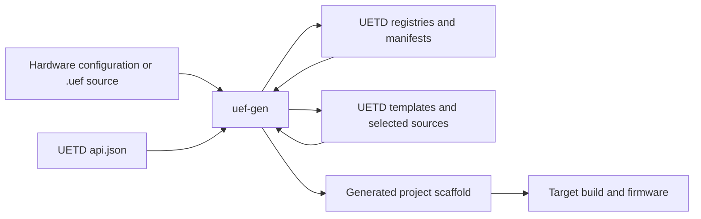

# Unified Embedded Framework (UEF)

UEF combines UETD, an allocation-conscious C11 embedded framework, with
`uef-gen`, a host-side Python project assembler. UETD owns the public embedded
APIs, module and target registries, algorithms, and templates. `uef-gen` reads
those live contracts to resolve hardware and assemble a firmware project
scaffold. Generated firmware does not need Python at runtime.



## Components

| Component | Role | Documentation |
|---|---|---|
| [UETD](UETD/README.md) | C11 APIs, hardware boundaries, middleware, protocols, algorithms, registries, and reusable templates | [Architecture](UETD/docs/ARCHITECTURE.md), [registry guide](UETD/registry/README.md), [UETD documentation index](UETD/docs/README.md) |
| [`uef-gen`](uef-gen/README.md) | Hardware/resource resolution, module selection, project assembly, provenance, and the standalone project-language frontend | [Architecture](uef-gen/docs/ARCHITECTURE.md), [language guide](docs/guides/UEF_PROJECT_LANGUAGE_GUIDE.md), [generator docs index](uef-gen/docs/README.md) |

The projects share versioned contracts, but each has one source of truth:
UETD owns its catalogues; `uef-gen` discovers them through the live UETD
checkout. The generator does not bundle a second copy of UETD's registries or
source tree.

## Current capability and limits

- UETD provides generic C implementations of PID and lead-lag control. Other
  algorithm catalogue entries remain scaffolds and fail closed.
- UETD includes target-family roadmaps and exact-part records, but the
  registered board profiles do not yet provide complete verified pin, clock,
  DMA, startup, linker, build, and flash data. Catalogue presence is not board
  qualification.
- `uef-gen` can validate hardware configuration and assemble a project
  scaffold. Its `.uef` and `.uefs` frontend can parse, resolve registries,
  perform semantic checks, and lower projects to backend-neutral models. A
  firmware emitter, complete target build, flashing, and wired monitoring are
  not available through that language path.
- Module and template presence does not imply that the implementation is
  complete or usable on a physical target. The component READMEs and registry
  readiness fields describe the supported boundaries.

See [UETD status](UETD/README.md) and the [`uef-gen` README](uef-gen/README.md)
for the current component inventories and command behavior.

## Build UETD

Requirements: CMake 3.20 or newer and a C11 compiler. A host build exercises
portable code and host simulation; it does not qualify an MCU or board.

```powershell
cmake -S UETD -B UETD/build -DUETD_TARGET=HOST -DUETD_UOS_BACKEND=BAREMETAL
cmake --build UETD/build
```

To include the minimal lifecycle example, add `-DUETD_BUILD_EXAMPLE=ON` during
configuration. Cortex-M builds require the selected CMSIS/device include path
and device header. FreeRTOS builds require the pinned kernel sources, a
supported architecture/compiler profile, and a project-provided
`FreeRTOSConfig.h`. FatFS is optional and consumer supplied. See the
[UETD build guide](UETD/README.md#build) for the available CMake options.

## Install and use `uef-gen`

Python 3.11 or newer is required. Install from the repository root:

```powershell
Push-Location .\uef-gen
python -m pip install -e ".[templates]"
Pop-Location
$env:UETD_PATH = (Resolve-Path .\UETD).Path
```

Inspect target records, validate a hardware configuration, and preview a
project scaffold:

```powershell
uef-gen targets list --include-scaffolds
uef-gen targets show <chip-id>
uef-gen validate .\path\to\hardware.yaml
uef-gen generate .\path\to\hardware.yaml --output .\build\firmware --dry-run
```

The repository does not include a hardware-only YAML example. The configuration
contract is defined in
[`uef-gen/schemas/project.schema.json`](uef-gen/schemas/project.schema.json).
A successful dry run or scaffold assembly does not certify target hardware or
produce a flash-ready image.

## UEF Project Language

The `.uef` format describes a standalone target project; `.uefs` composes
multiple target projects. The current frontend supports syntax parsing,
registry-backed name resolution, semantic diagnostics, editor analysis, and
backend-neutral lowering. Firmware emission and deployment remain unavailable.
The [user handbook](docs/guides/UEF_PROJECT_LANGUAGE_HANDBOOK.md) provides a
walkthrough; the [technical guide](docs/guides/UEF_PROJECT_LANGUAGE_GUIDE.md)
describes language rules; and the [registry guide](docs/guides/UEF_PL_REGISTRIES.md)
explains catalogue ownership and discovery. Registry-derived names and units
are listed in the [language catalogue](docs/reference/UEF_PROJECT_LANGUAGE_CATALOGUE.md)
and [unit reference](docs/reference/UEF_PL_UNITS_REFERENCE.md).

## Documentation and project policy

- [Repository documentation index](docs/README.md)
- [UETD documentation index](UETD/docs/README.md)
- [`uef-gen` documentation index](uef-gen/docs/README.md)
- [Release procedure](docs/RELEASING.md)
- [Contributing policy](CONTRIBUTING.md)
- [Code of Conduct](CODE_OF_CONDUCT.md)
- [Security policy](SECURITY.md)
- [Support](SUPPORT.md)
- [Changelog](CHANGELOG.md)

UEF and `uef-gen` are licensed under GNU GPL-3.0-only. Dependencies retain
their own license terms; see [`LICENSE.md`](LICENSE.md).
