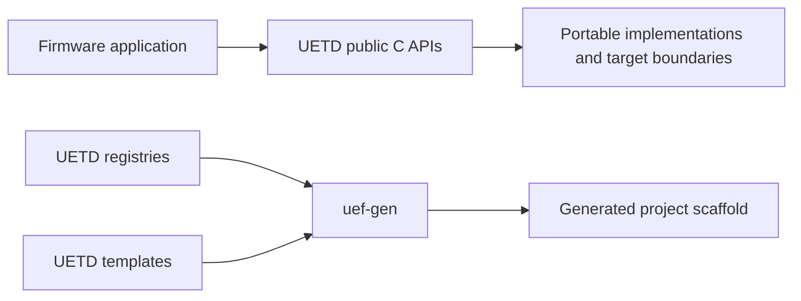

# UETD documentation

The [UETD README](../README.md) is the entry point for installing the library,
using its public C APIs, and understanding current readiness. This directory
holds the deeper architecture and engineering references.

UETD and `uef-gen` are licensed together under GPL-3.0-only; see the repository
[`LICENSE.md`](../../LICENSE.md). Third-party components retain their own terms.

UETD also supplies the JSON contracts consumed by the standalone project
language. For that authoring path, see the repository's
[UEF-PL user handbook](../../docs/guides/UEF_PROJECT_LANGUAGE_HANDBOOK.md)
and [registry/discovery guide](../../docs/guides/UEF_PL_REGISTRIES.md).

## Architecture and work

- [Architecture](ARCHITECTURE.md) maps ownership, APIs, generated artifacts,
  and runtime boundaries.
- [UOS API contracts and target qualification](design/UOS_CONTRACTS.md)
  specifies task/ISR contexts, synchronization results, FSM ingress, time,
  static storage, and the exact-target evidence boundary.
- [Implementation inventory](TODO.md) tracks incomplete work and promotion
  gates. A listed scaffold is not an implemented or selectable capability.
- [Equation and algorithm checklist](design/UETD_EQUATION_CHECKLIST.md) tracks
  implementation details for equation-bearing modules.

## Catalogues and audits

- [UMATH catalogue](catalogues/UMATH_CATALOGUE.md)
- [UETD system audit](audits/UETD_SYSTEM_AUDIT.md)
- [Source-equivalence and catalogue-gap audit](audits/UETD_EQUIVALENCE_AND_CATALOGUE_GAP_AUDIT.md)
- [UCON catalogue audit](audits/UCON_CATALOGUE_AUDIT.md)

## Roadmaps

- [UPROTO roadmap](roadmap/UPROTO_ROADMAP.md)
- [UCON roadmap extensions](roadmap/ROADMAP_EXTENSIONS.md)

Component-level READMEs remain beside their code and catalogue records so
contributors can find local contracts without leaving the relevant tree.
