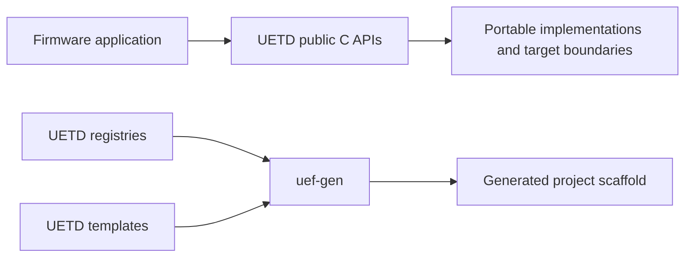

# UETD documentation

The [UETD README](../README.md) is the entry point for installing the library,
using its public C APIs, and understanding current readiness. This directory
holds the deeper architecture and engineering references.

For manually assembled projects using the completed portable UOS/UAPP first
pass, start with the [implementation and assembly guide](UOS_UAPP_FIRST_PASS.md).

For CPU versus SoC/SDK boundaries, bare chips and custom PCBs, UEF-PL hardware
settings, and the path to CLI/IDE flashing, read the
[UHAL porting and target integration guide](design/UHAL_PORTING.md).

UETD and `uef-gen` are licensed together under GPL-3.0-only; see the repository
[`LICENSE.md`](../../LICENSE.md). Third-party components retain their own terms.

UETD also supplies the JSON contracts consumed by the standalone project
language. For that authoring path, see the repository's
[UEF-PL user handbook](../../docs/guides/UEF_PROJECT_LANGUAGE_HANDBOOK.md)
and [registry/discovery guide](../../docs/guides/UEF_PL_REGISTRIES.md).

## Architecture and work

- [Folder structure and topic groups](STRUCTURE.md) explains the CAN family,
  matching header/source/manifest/template layout and single-file folder rule.
- [Architecture](ARCHITECTURE.md) maps ownership, APIs, generated artifacts,
  and runtime boundaries.
- The public API reference is generated from `include/` with Doxygen; see the
  [generation instructions](../README.md#api-documentation).
- [UOS API contracts and target qualification](design/UOS_CONTRACTS.md)
  specifies task/ISR contexts, synchronization results, FSM ingress, time,
  static storage, and the exact-target evidence boundary.
- [CANopen FD and MEDI CAN design](design/can/CANOPEN_FD_MEDI_CAN.md) separates
  CANopen CC, CAN FD transport and CANopen FD from protocol extensions.
- [Myovena MEDI CAN protocol](design/can/MEDI_CAN.md) defines the independent
  CANopen FD extension scaffold, acknowledged delivery, explicit loss/fault
  handling, durable recovery and trusted execution boundary.
- [Implementation inventory](TODO.md) tracks incomplete work and promotion
  gates. A listed scaffold is not an implemented or selectable capability.
- [Equation and algorithm checklist](design/UETD_EQUATION_CHECKLIST.md) tracks
  implementation details for equation-bearing modules.

## Catalogues and audits

- [Folder reorganisation and validation](audits/UETD_STRUCTURE_REORGANISATION_2026-10-30.md)
- [Final first-pass scaffold review](audits/UETD_FINAL_SCAFFOLD_REVIEW_2026-10-29.md)
- [Completed first-pass placement migration](audits/UETD_FIRST_PASS_MIGRATION_2026-10-29.md)
- [Critical whole-catalogue audit and implementation findings](audits/UETD_CRITICAL_CATALOGUE_AUDIT_2026-10-29.md)
- [Complete-system design](design/complete-system/README.md) and [first-pass scope/migration plan](design/complete-system/FIRST_PASS_SCOPE.md)
- [Myovena OLED handheld specifics and generic display driver](design/complete-system/MYOVENA_HANDHELD.md)
- [UMATH catalogue](UMATH_CATALOGUE.md)
- [UETD system audit](audits/UETD_SYSTEM_AUDIT.md)
- [Source-equivalence and catalogue-gap audit](audits/UETD_EQUIVALENCE_AND_CATALOGUE_GAP_AUDIT.md)
- [UCON catalogue audit](audits/UCON_CATALOGUE_AUDIT.md)

## Roadmaps

- [UPROTO roadmap](roadmap/UPROTO_ROADMAP.md)
- [Connectivity stack, controller firmware, and build artifact plan](roadmap/CONNECTIVITY_STACK_AND_ARTIFACT_PLAN.md)
- [UCON roadmap extensions](roadmap/ROADMAP_EXTENSIONS.md)

Component-level READMEs remain beside their code and catalogue records so
contributors can find local contracts without leaving the relevant tree.
