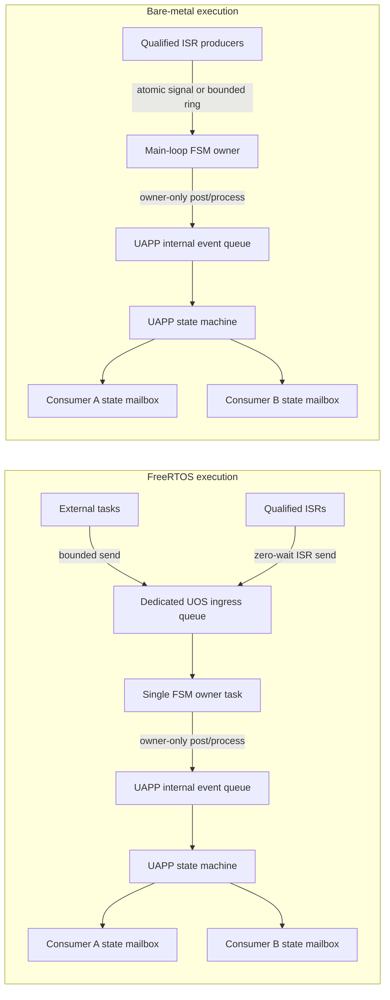

# UOS API contracts and target qualification

This document defines the portable behavior required of UOS and records how
the current backends compare. The public interface is in
[`include/uos/uos.h`](../../include/uos/uos.h); backend behavior is in
[`src/uos/baremetal/baremetal.c`](../../src/uos/baremetal/baremetal.c) and
[`src/uos/freertos/freertos.c`](../../src/uos/freertos/freertos.c).

The header currently exposes no UOS result enum. Several operations return
`bool`, `void`, or a zero-valued count/bitmask, so callers cannot distinguish
all failures. The **Required contract** sections define the target API;
**Current behavior** labels describe what the checked-in source does.

## Backend capability boundary

| Backend | Current behavior | Contract boundary |
| --- | --- | --- |
| Bare metal | `uos_time_now()` forwards to `uetd_time_now_us()`. Delays busy-wait. Task creation and scheduler start do not create or start tasks. Mutex, semaphore, queue, and event operations are unsupported stubs; their return values may look like ordinary failure, empty, or success. | The application main loop is the sole execution owner. The backend does not provide a synchronized ingress queue or RTOS blocking primitives. ISR ingress requires a separately implemented, target-qualified signal or bounded buffer. |
| FreeRTOS | Static task, mutex, counting semaphore, queue, and event-group wrappers use FreeRTOS Kernel 11.3.1 APIs. The UOS queue copies item bytes. Result reporting is mostly boolean, `void`, or a neutral value. | Task APIs are usable only with the selected kernel configuration and a valid port. ISR entry points are limited to the explicit `*_from_isr` functions and remain subject to the port's interrupt-priority rules. |
| SafeRTOS outline | Operation-shaped source exists under `src/uos/future/safertos/`; it is not selected by CMake and contains unimplemented operations. | No SafeRTOS capability is available until a licensed package, exact port contract, implementation, and qualification record exist. |

## Execution ownership and ingress

External input delivery and FSM processing are separate bounded stages. The
FSM remains single-owner: only its owner task or main loop calls the UAPP FSM
API. The UAPP event queue remains private to that FSM instance, and each
subscriber's latest-state mailbox remains independent of both queues.



### RTOS ingress contract

- Create a dedicated, statically backed UOS queue for external FSM inputs.
  The owner task is its only consumer. The queue is not the UAPP internal
  event queue and is not a state mailbox.
- Configure record size and queue depth at build time. Derive depth from the
  maximum producer burst and owner service latency; no capacity is universally
  safe for every application.
- Producers publish complete, fixed-size event records. Queue item copying
  transfers the record value; pointer members, if any, remain shallow borrowed
  references and require a separately defined lifetime.
- A multi-task producer set uses the FreeRTOS queue's synchronized task API.
  An ISR producer uses `uos_queue_send_from_isr()` only from an interrupt
  priority permitted to call FreeRTOS APIs. ISR sends never wait. A mixed
  task/ISR queue is valid only when all producers use the matching context API
  and the selected port's priority/yield rules are met.
- FreeRTOS queues support multiple task producers and consumers. The FSM
  ingress queue is intentionally MPSC with exactly one owner-task consumer;
  multiple consumers would divide records between tasks and violate FSM
  ownership. Multiple ISR producers are allowed only through the ISR API and
  only when the selected port safely serializes their priorities/nesting.
- A full ingress queue rejects the newest record. Producers check the result;
  task producers use a bounded wait only when the application deadline permits
  it. Critical causes require a sticky cause, reliable mailbox/back-pressure,
  or independent hardware-safe action; an ordinary FIFO alone is not a safety
  mechanism.
- Only the owner drains ingress and invokes the FSM. For event-driven UAPP,
  that owner may post copied records to the separate UAPP event queue. For the
  UEF-PL adapter, input routes update the activation snapshot before the
  owner processes its synthetic tick. Generated callbacks do not post
  arbitrary external events to the same machine.
- Each state subscriber receives a separate latest-value mailbox. A new state
  snapshot replaces that subscriber's unread snapshot; it does not preserve a
  history of state changes and does not consume another subscriber's value.

### Bare-metal ingress contract

- The main loop owns all FSM initialization, posting, processing, reset, and
  callbacks. An ISR never calls the UAPP FSM API directly.
- ISR input uses a target-qualified atomic signal for coalescible conditions,
  or a fixed-capacity ring for records that must be retained. A signal may
  collapse repeated occurrences and is unsuitable when every event matters.
- An SPSC ring has exactly one fixed producer context and the main loop as
  consumer. Multiple or nestable ISR producers require a qualified
  multi-producer algorithm or producer serialization. Atomic width,
  lock-freedom, interrupt masking, memory ordering, and overflow behavior are
  target properties; a generic Cortex-M label does not establish them.
- The bare-metal UOS backend currently implements no queue or ISR ingress.
  These requirements describe the application/target boundary until a
  supported mechanism is implemented and qualified.

## Synchronization, waits, and result semantics

### Polls and timeouts

For queue send/receive, mutex lock, semaphore take, and event wait:

| `timeout_us` | Required meaning |
| --- | --- |
| `0` | **Poll.** Make one immediate attempt and return without waiting. A queue send reports full, receive/take/event wait reports empty or no matching event, and a mutex lock reports busy. |
| `1..UOS_WAIT_FOREVER-1` | **Finite wait.** Wait until the operation succeeds or one deadline measured from the call is reached. Return timeout if the condition is still false at the deadline. Tick quantization may delay observation until the first tick boundary at or after the deadline; it must not silently turn a finite duration into an unbounded wait. |
| `UOS_WAIT_FOREVER` | Wait without a deadline only for APIs and backends that explicitly support blocking. It is invalid for a busy-wait delay or periodic deadline. Bare-metal synchronization operations are unsupported. |

The FreeRTOS adapter currently rounds positive waits up to ticks and clamps
large values to `portMAX_DELAY`; an arithmetic overflow also maps to
`portMAX_DELAY`. These paths can conflate a very long finite wait with an
unbounded wait, depending on kernel configuration. The bare-metal delay
forwards every duration to a spin delay, so `UOS_WAIT_FOREVER` must not be
passed to it.

### Required result model

Replace ambiguous return values with a UOS result type and output parameters
for data-bearing calls. The following names and distinctions form the target
contract; they are not declared by the current header.

| Result | Meaning |
| --- | --- |
| `UOS_OK` | The requested operation completed. |
| `UOS_TIMEOUT` | A positive finite blocking wait expired before the condition became true. |
| `UOS_EMPTY` | A zero-time poll found no queued item, token, or requested event bit. |
| `UOS_FULL` | A zero-time queue send found no free slot, or a semaphore give found its configured maximum count. |
| `UOS_BUSY` | A zero-time mutex lock found the mutex held, or an operation cannot proceed because of a transient busy state. |
| `UOS_INVALID_PARAM` | A required pointer, size, depth, mask, duration, or value is outside the API's declared range. |
| `UOS_NOT_READY` | A valid opaque object has not been created, or a required scheduler/runtime state is not ready. |
| `UOS_NOT_SUPPORTED` | The selected backend does not implement the requested capability. |
| `UOS_OVERFLOW` | A duration, tick conversion, deadline, capacity calculation, or counter cannot be represented without changing the requested meaning. |
| `UOS_NOT_OWNER` | A task attempted to unlock a mutex it does not own. |
| `UOS_BACKEND_ERROR` | The selected backend rejected an operation for a reason not represented by the other statuses; preserve the native failure where available. |

For positive waits, an unsuccessful queue/semaphore/event/mutex wait returns
`UOS_TIMEOUT`; `UOS_EMPTY`, `UOS_FULL`, and `UOS_BUSY` are reserved for polls
or immediate state checks. Invalid input and unsupported backend behavior
must not be reported as a timeout or as an empty object.

| Operation | Required result and output behavior |
| --- | --- |
| Static create | `UOS_OK` only after a usable object is created. Reject invalid dimensions, alignment, or backing storage. A failed create leaves the object unusable and reports the reason. |
| Queue send | Poll on zero: `UOS_FULL` if no slot. Positive wait: `UOS_TIMEOUT` on deadline. `UOS_OK` means exactly one item copy was accepted. |
| Queue receive | Poll on zero: `UOS_EMPTY` if no item. Positive wait: `UOS_TIMEOUT` on deadline. On any failure, caller output storage remains unchanged. |
| Queue waiting count | Return status and write count through an output pointer; zero is a valid count, not an error sentinel. The count is an instantaneous snapshot and must not be used as a reservation. |
| Mutex lock | Poll on zero: `UOS_BUSY` if held. Positive wait: `UOS_TIMEOUT`. Only the owning task may unlock; unlocking an unowned mutex reports `UOS_NOT_OWNER`. |
| Semaphore take/give | Poll on zero with count zero: `UOS_EMPTY`; a finite wait expires as `UOS_TIMEOUT`. Give at maximum reports `UOS_FULL`; no token is silently discarded. |
| Event wait | Use wait-any semantics for the requested mask. Poll with no requested bit set: `UOS_EMPTY`; finite wait expiration: `UOS_TIMEOUT`. Return `snapshot & mask` through an output parameter and atomically clear the matched bits on success; leave unrelated bits set. |
| Event set/clear | Return status. Reject zero/unsupported bit masks according to the declared valid-bit mask; never discard FreeRTOS errors silently. |
| ISR queue/semaphore/event operation | Return status and initialize optional `higher_priority_woken` output to false before attempting the operation. Report queue full, semaphore full, invalid input, unsupported context, deferred-event-command queue full (`UOS_FULL`), or other backend failure. |
| `uos_task_delay_until` | Return status for invalid input and deadline overflow. On failure, leave the caller's deadline unchanged. |
| Task create/delay/scheduler | Return status for invalid arguments, unsupported bare-metal tasking, delay overflow, and backend startup failure. A zero task delay is a yield; `UOS_WAIT_FOREVER` is invalid for delay. |
| Current time | Return status and write the time through an output pointer; distinguish invalid output storage and an uninitialized clock from a valid timestamp of zero. |

Representative declarations for the result-bearing API are:

```c
typedef enum {
    UOS_OK = 0,
    UOS_TIMEOUT,
    UOS_EMPTY,
    UOS_FULL,
    UOS_BUSY,
    UOS_INVALID_PARAM,
    UOS_NOT_READY,
    UOS_NOT_SUPPORTED,
    UOS_OVERFLOW,
    UOS_NOT_OWNER,
    UOS_BACKEND_ERROR
} uos_status_t;

uos_status_t uos_time_now(uos_time_t* now_us);
uos_status_t uos_queue_waiting(const uos_queue_t* queue, uetd_u32_t* count);
uos_status_t uos_event_wait(uos_event_t* event, uetd_u32_t mask,
                            uos_dur_t timeout_us, uetd_u32_t* matched_flags);
uos_status_t uos_task_delay_until(uos_time_t* next_us, uos_dur_t period_us);
```

All required output pointers are validated before the operation begins. Output
storage remains unchanged on failure. If the optional `higher_priority_woken`
pointer is supplied, it is initialized to false before an ISR operation. A
`void` return remains appropriate only for operations that cannot fail and
have no capacity, ownership, or backend-dependent outcome (for example, a
documented no-fail yield primitive).

The required event contract is wait-any. A successful wait reports
`matched_flags = snapshot & mask` and clears those matched bits atomically as
part of the successful wait; unrelated bits remain set. A set operation
releases every waiter whose mask matches at that set operation; each matching
waiter receives the matching snapshot before clear-on-exit takes effect.
Concurrent set, clear, and wait operations are serialized by the backend.
Reject masks containing bits outside the usable `EventBits_t` range of the
selected kernel configuration.

The current FreeRTOS event wait is wait-any with clear-on-exit enabled. It
returns the entire event-bit snapshot from FreeRTOS, not a status; zero can
mean invalid input or timeout. Its ISR set operation is deferred through the
FreeRTOS timer command queue, and the wrapper currently discards the enqueue
failure status. Semaphore give, event set/clear, mutex unlock, and queue count
also discard or collapse failure information. These are API gaps, not
guarantees of success.

The current FreeRTOS ISR wrappers invoke `portYIELD_FROM_ISR()` internally.
The `higher_priority_woken` output is informational; callers must not add a
second port yield for the same UOS call. Keep this ownership explicit in each
port adapter.

## Execution-context table

Until a target contract explicitly broadens a row, public UOS calls are task
or main-loop APIs. Object creation and task creation may run during startup
before the scheduler. Blocking, yielding, and synchronization operations run
only in a task after scheduler startup; calls before that point return
`UOS_NOT_READY`. ISR use is restricted to the three named `_from_isr`
operations in the FreeRTOS backend.

| API family | FreeRTOS task context | FreeRTOS ISR context | Bare-metal main loop | Bare-metal ISR |
| --- | --- | --- | --- | --- |
| `uos_time_now` | Supported after target clock setup, before or after scheduler startup; epoch remains inconsistent today. | Not part of the portable contract. | Forwards to UCORE/UHAL clock. | Not part of the portable contract. |
| Task create/scheduler start | Task creation and scheduler start run during startup; scheduler start is not an ISR call. Task creation after startup is task-context only. | Unsupported. | Create returns false; scheduler start is a no-op because the main loop owns execution. | Unsupported. |
| Delay/yield/deadline | Task context after scheduler startup. | Unsupported. | Delay spins; yield is a no-op. | Unsupported. |
| Mutex create/lock/unlock | Create during startup or task context; lock/unlock only in a task after scheduler startup. Lock may block. | Unsupported. | Unsupported stubs. | Unsupported. |
| Semaphore create/take/give | Create during startup or task context; take/give only in a task after scheduler startup. Take may block. | Only `uos_sem_give_from_isr()`, with a valid FreeRTOS-callable interrupt priority. | Unsupported stubs. | Unsupported. |
| Queue create/send/receive/count | Create during startup or task context; send/receive/count only in a task after scheduler startup. Send/receive may block. | Only `uos_queue_send_from_isr()`, with a valid FreeRTOS-callable interrupt priority; never blocks. | Unsupported stubs. | Unsupported. |
| Event create/wait/set/clear | Create during startup or task context; wait/set/clear only in a task after scheduler startup. Wait may block. | Only `uos_event_set_from_isr()`. The operation is deferred and depends on the FreeRTOS timer service configuration. | Unsupported stubs. | Unsupported. |

The exact FreeRTOS interrupt priority threshold, priority grouping, ISR yield
macro, timer-daemon queue capacity, timer-task priority/stack, and clock/tick
configuration come from the selected port and `FreeRTOSConfig.h`; they are not
specified by the generic `arm_cm4f_gcc` profile.

## Object lifetime, copying, and concurrency

- UOS objects and buffers use caller-provided storage; `static` describes the
  allocation strategy, not the C storage-duration keyword. Keep the opaque
  object, task stack, and queue item buffer alive and at fixed addresses for as
  long as the kernel can reference them. A task's context pointer must remain
  valid for as long as the task can use it. No destroy operation exists in the
  current API.
- Create each object once before use. Do not copy or move an initialized
  opaque object. Do not access it before successful creation. A future API
  must either detect use-before-create or state it as a strict precondition;
  the current byte-storage wrapper has no initialization marker.
- `uos_queue_create_static()` requires an item size and depth greater than
  zero and backing storage for at least `item_size * depth` bytes. The source
  checks product overflow but has no backing-buffer length parameter, so the
  caller must provide the full extent. `item_size` and `depth` must also fit
  the selected kernel's `UBaseType_t` before narrowing; the current wrapper
  does not check those conversions. Align the item buffer for the stored item
  type. Item bytes are copied on send and
  receive; pointed-to data is not deep-copied. The producer's source record
  need remain valid through the send call, and the consumer's destination
  record must be writable for the full item size.
- FreeRTOS queues provide synchronized task send/receive operations and can
  support multiple task producers and consumers. The accepted item order is
  queue order; producer call-start order and waiter fairness are not promised.
  ISR producers share the queue only through the ISR API and valid port rules.
  The bare-metal UOS queue currently supports no producer/consumer model.
- Event flags represent coalescible conditions, not event counts. All waiters
  matched by one set operation may observe that matching snapshot; a later
  waiter does not receive an already-cleared bit. Semaphore and mutex waiter
  fairness is backend-defined unless a selected target profile states a
  stronger scheduling rule.
- Mutexes have one owning task at a time; they are not recursive unless a
  future API explicitly says so. Semaphore count is bounded by `maximum`.
  Event flags are shared bits, not queued occurrences; repeated sets can
  coalesce. Wait-any and clear-on-exit details must be identical across
  backends.
- Opaque-storage sizes and alignments are ABI properties. Compile-time checks
  must compare every wrapper to each selected concrete control block under
  each supported compiler, ABI, kernel configuration, and port. A generic
  family record is not evidence that the assertions passed for a board build.

## Monotonic time and deterministic deadlines

### Common epoch

The required UOS epoch is the target's monotonic system-start epoch in
microseconds, shared with `uetd_time_now_us()`. `uos_time_now(uos_time_t*)`
returns `UOS_OK` and writes the timestamp, or returns `UOS_INVALID_PARAM` for
null output storage and `UOS_NOT_READY` before target clock initialization;
failure leaves the output unchanged. The clock is independent of whether an
RTOS scheduler is running. Before scheduler start, it remains usable after
target clock initialization and returns elapsed time from that same epoch;
scheduler start must not reset it. A valid time of zero is distinct from an
initialization failure.

`uos_time_t` is 64-bit. Hardware counter wrap must be extended without a
backward jump. At the representable limit, time saturates rather than wrapping
to zero; checked deadline arithmetic reports `UOS_OVERFLOW`. Any implementation
using modular counter arithmetic must prove its sampling interval and maximum
representable elapsed duration.

**Current mismatch:** bare metal forwards to UCORE's system-start clock, while
FreeRTOS converts `xTaskGetTickCount()` to microseconds. The FreeRTOS value is
tick-quantized, tied to scheduler ticks, and can wrap with `TickType_t`;
therefore it does not currently satisfy the common epoch contract. Cortex-M
UCORE time returns zero when cycles-per-microsecond is not initialized.

### `uos_task_delay_until`

The API uses an absolute `next_us` in the common epoch and a positive period.
The value is a cadence anchor, not “now plus period” on each call. The caller
exclusively owns the deadline storage for the duration of the call; concurrent
updates to the same deadline are invalid. Initialize it to the first desired
release in the common epoch; `now + period` is the usual first release, while
`now` requests an immediate first release. Check that initialization addition
for overflow. The required transaction is:

1. Validate `next_us` and `period_us > 0`; preserve the input value on error.
2. If the scheduled deadline is in the future, wait for it. If it is due or
   late, do not add an extra initial wait.
3. Sample the monotonic clock after waiting. Compute the first release
   `candidate = old_deadline + n * period_us` that is strictly later than the
   sample, where `n >= 1`. This skips missed releases without changing the
   original cadence.
4. Check the period-count increment, multiplication, and final addition before
   committing `candidate` to `*next_us`. If any calculation is unrepresentable,
   return `UOS_OVERFLOW` and leave `*next_us` unchanged. Waiting already
   performed cannot be rolled back.

The current function returns `void`. Both implementations add one period
without checking overflow before writing the result; their later missed-period
guard cannot undo that wrapped write. Invalid pointer or zero period silently
returns. The current function therefore does not provide transactional
failure semantics.

### Duration conversion

`UOS_MS(n)` and `UOS_S(n)` multiply before the cast and can wrap in unsigned
64-bit arithmetic. Replace them for untrusted or computed values with checked
conversion functions that write the output only on success, for example
`uos_duration_from_ms(uint64_t, uos_dur_t*)` and
`uos_duration_from_s(uint64_t, uos_dur_t*)`. The valid input bounds are
`milliseconds <= UINT64_MAX / 1000` and
`seconds <= UINT64_MAX / 1000000`; invalid conversion reports `UOS_OVERFLOW`
and leaves the output unchanged.

For a FreeRTOS finite wait duration `d > 0` and tick rate `f > 0`, conversion
uses checked arithmetic and rounds up:

```text
ticks = ceil(d * f / 1,000,000)
```

A positive duration never becomes a poll. If the rounded result exceeds the
representable finite tick range, report overflow/range error rather than
silently mapping it to `portMAX_DELAY`. Zero remains the poll value for
synchronization calls; `UOS_WAIT_FOREVER` is handled separately and only by
blocking APIs.

## Opaque storage checks

The public wrappers currently request 8-byte alignment and reserve 512 bytes
for tasks, 80 for mutexes, 80 for semaphores, 112 for queues, and 64 for event
groups. The FreeRTOS adapter contains compile-time `sizeof` checks for all five
control-block types and `_Alignof` checks for task, semaphore, queue, and event
types. Mutexes share the semaphore control-block type. These checks run only
when the selected FreeRTOS source is compiled; they do not establish support
for every vendored FreeRTOS port, compiler, ABI, or configuration.

The qualification contract requires, in every supported build:

- `sizeof(ConcreteControlBlock) <= sizeof(UOSStorage)` for each of task,
  mutex, semaphore, queue, and event objects;
- `_Alignof(ConcreteControlBlock) <= _Alignof(UOSWrapper)` for each matching
  wrapper type, including task and semaphore wrappers;
- compile-time checks for each selected port/configuration, with C11 and C++
  public-header layout verified where both languages are supported; and
- failure at compile/configure time when either size or alignment does not fit.

The current adapter uses `<= UOS_STORAGE_ALIGN` rather than asserting the
alignment of every concrete wrapper pair, and only one generic FreeRTOS port
profile is described. The source and profile data do not prove all compiler
and ABI combinations.

## Exact target profile and qualification record

`arm_cm4f_gcc` selects FreeRTOS Kernel 11.3.1 common sources, the
`portable/GCC/ARM_CM4F` port, and `heap_4.c`. The lock records upstream tag
`V11.3.1` and commit
`3a22924e0a9ddbbc8b0758881c33b3422a5cc20d`; the staged source has not been
checksum-compared with that commit. The profile names `arm-cortex-m4f` and
`gcc-arm-none-eabi`, but does not pin a compiler release, MCU, board revision,
ABI flags, clock tree, startup code, linker script, or FreeRTOS configuration.
It is a source-selection profile, not a production target qualification.

Each qualified deployment requires a versioned record containing:

| Area | Required target-specific data |
| --- | --- |
| Silicon and board | Exact MCU ordering code and package, board/carrier revision, oscillator sources, memory map, relevant errata, and board schematics/reference. |
| Compiler and ABI | Compiler executable/version, target triplet, C standard, ABI and FPU mode, code-generation flags, assembler/linker versions, and binary format. |
| RTOS | Kernel version and verified source hash, exact port path/version, `FreeRTOSConfig.h` hash, static-allocation settings, tick width/rate, timer-service settings, stack-depth type, and heap policy. |
| Clock and timebase | Oscillator frequency/tolerance, PLL and bus divisors, clock-switch sequence, timer/DWT source, tick source, conversion constants, and initialization order. |
| Startup and memory | Reset/vector startup source and revision, interrupt table, linker script/hash, RAM/flash regions, stack placement, cache/MPU policy, and DMA-visible regions. |
| Interrupts | Priority grouping, syscall-safe priority threshold, every UOS-using IRQ priority, nesting policy, and ISR-yield implementation. |
| Validation evidence | Scheduler start/return behavior, clock epoch and drift/jitter, deadline overrun and wrap cases, queue copy/FIFO/full/empty behavior, each ISR-safe path, overflow handling, and static-storage assertions on the exact build. |

Hardware evidence is required for each exact profile. A successful host build,
generic Cortex-M profile selection, or compile-time storage assertion does not
establish scheduler, timing, interrupt, electrical, or board behavior.

## Implementation sequence

1. Publish the result enum and status-returning APIs; define poll, finite
   timeout, forever, output-preservation, event-mask, and ISR semantics.
2. Bring both backends to the same monotonic epoch and checked
   `delay_until`/duration-conversion contract. Keep unsupported bare-metal
   synchronization explicitly unavailable until an implementation exists.
3. Add the dedicated RTOS ingress queue and target-qualified bare-metal ISR
   ingress mechanism while preserving the single FSM owner and distinct
   internal queue/state mailboxes.
4. Extend opaque-storage size/alignment assertions across every supported
   compiler, ABI, configuration, and concrete port.
5. Mark a deployment qualified only after its exact target record and
   hardware evidence cover the behaviors above.

