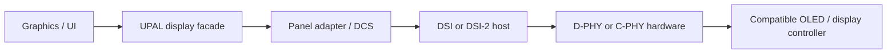

# MIPI display link: DSI, D-PHY and C-PHY

First-pass display-provider design, 29 October 2026. This refines the existing
`upal/display` requirement and the [Myovena handheld](MYOVENA_HANDHELD.md).
It does not add a qualified controller, panel or PHY implementation.

## Decision and layers

Include a MIPI display-provider route in first-pass scope. For the handheld,
evaluate DSI over D-PHY as the initial reference route. Evaluate DSI-2 over
C-PHY when a candidate host and panel support the same required profile.
This is an engineering starting point; the panel, host and bandwidth comparison
must decide the hardware. C-PHY belongs in the first-pass compatibility model
and does not require every target to implement it.

| Layer | Responsibility | UETD ownership |
|---|---|---|
| Graphics/UI | Compose pixels; own widgets, assets and input | Bounded GUI adapter above the display driver |
| Generic display | Pixel formats, regions, borrowed-buffer lifetime, status, sleep/brightness capabilities | Existing `upal/display` facade |
| Panel/control | DCS and vendor-specific initialization, reset/power sequencing, supported modes and orientation | Exact panel profile and panel adapter |
| DSI/DSI-2 host | Packet/command transfer, video timing, FIFO/DMA, synchronization, bounded error/recovery handling | UPAL display-host provider backed by the selected controller/SDK |
| D-PHY or C-PHY | Electrical signalling, clocking and physical link states | Actual host/bridge PHY hardware, configured by its target provider |
| Board | Power, connector, routing, reset/TE/IRQ signals and memory | Exact board/resource profile |

[DSI](https://www.mipi.org/specifications/dsi) uses D-PHY.
[DSI-2](https://www.mipi.org/specifications/dsi-2) supports D-PHY and C-PHY;
the exact version/features at both ends must match. The
[Display Command Set](https://www.mipi.org/specifications/display-command-set)
defines display-control commands. A panel can additionally need vendor commands.
DSI-2 also has longer-reach ecosystem options; they are not required by this
internal handheld display route.

The MIPI link is a local wired display connection. BLE and WiFi continue to
serve product communication through their own providers. Touch uses the actual
module's declared interface and interrupt/reset path; a display link alone
does not establish touch support.

## PHY compatibility

| Candidate | Facts the resolved profile must declare |
|---|---|
| D-PHY | Exact revision, differential data-lane count/mapping, supported lane rates and selected clock mode. Conventional forwarded-clock links use a separate differential clock pair; newer D-PHY offers optional embedded clock, which must be supported at both ends |
| C-PHY | Exact revision, number/mapping of three-wire trios, supported symbol rate and encoding mode. C-PHY embeds clock information in its signalling |
| Combo PHY or bridge | Which PHY mode is actually implemented and selected, supported input/output protocols, rates, control interface, buffering, reset/power sequence and firmware/driver identity |

Sources: [D-PHY](https://www.mipi.org/specifications/d-phy) and
[C-PHY](https://www.mipi.org/specifications/c-phy).
D-PHY lanes and C-PHY trios are distinct resources. Their quoted rates cannot
be compared by treating bits/s and symbols/s as interchangeable. A combo-capable
implementation must explicitly support the chosen mode; connector shape and
the word "MIPI" do not establish compatibility.

A camera-only CSI receiver does not satisfy the display-host requirement.
A software configuration change cannot supply a missing transmitter or PHY.
An external bridge is a valid provider route if its complete input-to-panel
path meets the timing, ownership and recovery contract.

## Required provider and panel profile

Resolve these facts before generating a MIPI display configuration. Unknown
required facts are blockers, not defaults inferred from screen size or OLED.

- Exact host controller, transmit capability, SDK/driver revision, DSI/DSI-2
  features, PHY revision/mode, lanes or trios, legal rates and board mapping.
- Exact panel/controller revision, native resolution, refresh range, supported
  command/video modes, wire pixel formats, orientation and virtual-channel use.
- Horizontal/vertical active dimensions, porches and sync widths; host pixel
  clock, packet scheduling and panel-required blanking/transition constraints.
- Panel initialization commands and their order, maximum lengths, required
  waits, readable identity/status where available, supply/reset sequence and
  brightness/sleep/display-on/off commands. Store a bounded typed sequence with
  provenance; execute it through the provider, not as arbitrary generated code.
- Supported DCS/generic read/write transfers, maximum payload and return size,
  LP/HS command policy, return-path/turnaround support, timeouts and supported
  completion/error reports. Mark unsupported optional operations explicitly.
- TE/vsync availability, physical signal or in-band source, clock domain,
  interrupt/deferred delivery, timeout and fallback. Panel RAM and partial
  updates require explicit panel/host support.
- Memory and wire pixel formats separately. For example, BGRX8888 storage does
  not imply a 32-bit-per-pixel wire stream. Declare any conversion, packing,
  byte/colour order, framebuffer placement and conversion scratch/work bounds.
- Host FIFO, DMA/display engine, bus access, cache maintenance, alignment,
  clocks/PLL, reset, interrupts and any shared-controller/PHY resource conflicts.
- DSC or other compression only when encoder, host and panel all support the
  exact selected configuration. Include encoder resources and output bounds;
  compression is not an implicit bandwidth remedy.

Own reusable DSI host operations under UPAL. Keep register access and PHY
programming in target providers; keep panel command sequences in panel profiles.
UAPP/GUI code uses the generic display API. A UPROTO network-session module is
not required for the local display link. The current generic API remains
transport-independent; it does not expose controller registers or raw DCS to
application code.

Draft typed scaffolds now exist in [dsi_host.h](../../../include/upal/display/dsi_host.h)
and [display_panel.h](../../../include/upal/display/display_panel.h), with unsupported
source definitions. These are not functioning target providers or a completed
target schema. Review/refine their profiles against the selected hardware and
map resources into the exact-target graph before implementation is qualified.

## Bandwidth and memory feasibility

Start with the uncompressed active-image payload:

`active_bits_per_second = width * height * refresh_hz * wire_bits_per_pixel`.

For the handheld document's hypothetical 1280 by 800, 60 Hz, RGB888 mode,
this is 1,474,560,000 bit/s, or about 1.475 Gbit/s. Spread over four D-PHY data
lanes this is 368.64 Mbit/s per lane before overhead. This calculation does
not qualify a four-lane host, panel, refresh rate or lane speed.

Compute the actual required rate from the selected display mode, packetization,
blanking policy, transition/command windows and panel constraints. Check it
against both endpoints' supported rates, PLL/divider quantization and physical
link limits. C-PHY feasibility must use its selected encoding and symbol-rate
limits rather than this D-PHY per-lane calculation.

Separately budget framebuffer scanout, rendering, copies/conversion, memory
refresh and radio/CPU contention. Command-mode dirty updates only reduce traffic
when panel RAM and synchronization support them. A fast serial PHY does not
remove the need for sufficient accessible memory and sustained memory bandwidth.

## Runtime, ownership and recovery

One task/main-context owner serializes panel state and host commands. The
bounded provider state machine covers powered-off, reset/init, ready, active,
sleeping, recovering and failed states. Each wait and recovery attempt has a
deadline and bounded retry/work count. An ISR records bounded status/events;
it does not execute the panel initialization script or GUI.

Preserve the generic display contract: one borrowed pixel request in flight;
exactly one terminal completion after access to caller pixels has ceased.
DMA admission is not completion. A scanout provider copies into provider-owned
frame storage before releasing caller pixels. Panel visibility/tearing and
presentation timing are separately declared provider facts. Stop/sleep/brightness
continue to reject a pending request under the existing facade rules.

On FIFO starvation, transfer timeout, synchronization loss or link/panel reset,
record available hardware error information, stop or quiesce further pixel
access, then publish the terminal result. A reset request alone does not prove
that DMA/scanout has stopped reading borrowed memory. Recovery may reinitialize
the panel; bound its duration and invalidate presentation state. Retain product
session state independently and gate touch/control interaction until the UI is
coherent again.

## Acceptance and implementation status

Before enabling generation for a concrete provider:

1. Reject incompatible protocol/PHY modes, lane/trio assignments, rate/timing
   combinations, unsupported pixel formats and unresolved resource conflicts.
2. Qualify color/packing, orientation, full-screen and dirty-region patterns;
   check command/video and TE/vsync behavior for the supported subset.
3. Test timeout/cancel, late IRQ/completion, FIFO starvation, panel/host reset,
   sleep/wake and supply interruption without premature buffer release.
4. Measure sustained display plus BLE/WiFi/TLS load, memory bandwidth, UI latency,
   power and recovery time on the exact board; check the actual PCB/flex link.
5. Lock host/panel/provider identities and retain the configuration and evidence.

Only the generic display facade is implemented today. DSI-host, DCS/panel and
D-PHY/C-PHY target-provider qualification remain required first-pass work.
MIPI public overviews establish the architectural distinction; exact timing,
electrical and command implementation requires the applicable specifications
and selected host/panel documentation.
