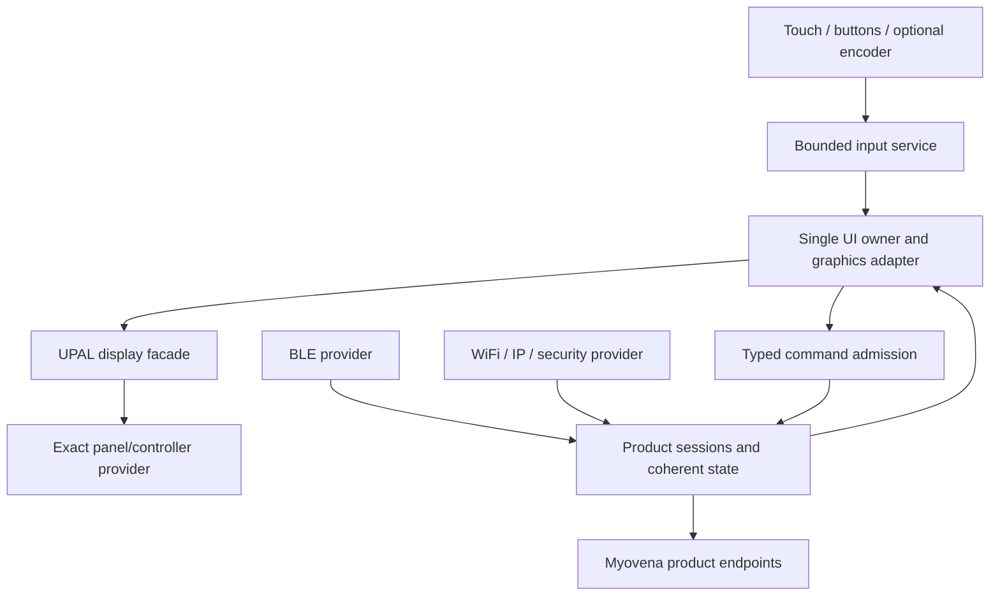

# Myovena handheld: display and product-control specifics

First-pass requirement, 29 October 2026. The user describes a bespoke handheld
control device for Myovena products, probably an OLED touchscreen around 7
inches, connected through BLE and WiFi. MCU, panel/controller, resolution and
touch controller have not been selected. This document records the specifics;
the reusable driver lives in the normal UPAL catalogue.

## Generic driver and ownership

Use [`upal/display/display.h`](../../../include/upal/display/display.h) and
[`src/upal/display/display.c`](../../../src/upal/display/display.c) as the panel-independent
provider facade. It supports command panels, RGB/MIPI-DSI scanout providers and
display coprocessors. No panel, MCU, radio, GUI library or framebuffer is
embedded in that driver. The main `upal/display` module is Phase 0 and remains
generation-blocked until an exact target/provider is integrated and qualified.

The implementation validates capabilities, dimensions, pixel formats, alignment,
stride, buffer extent and checked size arithmetic. It copies the request
descriptor, borrows the pixels, admits one in-flight transaction, and gives it
a non-repeating request ID. Providers must complete accepted work exactly once,
including timeout/cancel, after all pixel access has ceased. Requesting cancel
does not release memory. Stop, sleep and brightness changes reject a pending
transfer. Malformed/stale completion records do not release the pixel loan.

The initial scanout contract uses provider-owned frame storage: copy from the
submitted pixels before releasing them. Zero-copy front-buffer leases need a
separate reviewed presentation contract; they are not implied by completion
of a buffer copy. Fonts, widgets, image decoding, compositing and touch belong
above this driver. Draft source scaffolds now cover the
[DSI host](../../../include/upal/display/dsi_host.h),
[panel control](../../../include/upal/display/display_panel.h),
[touch](../../../include/upal/display/touch.h),
[input service](../../../include/umid/ui/input.h) and
[graphics adapter](../../../include/umid/ui/graphics.h). Each returns unsupported;
their target/provider and GUI integration remain implementation work.

## First-pass stack

A pinned LVGL adapter is the preferred graphics/UI integration design. LVGL
provides display and input integration points; UETD must supply bounded memory,
task ownership and correct transfer completion. References:
[LVGL porting](https://lvgl.io/docs/open/examples/porting),
[LVGL driver integrations](https://lvgl.io/docs/open/9.0/integration/driver/).
The provider selects an exact compatible release/configuration rather than
tracking an unspecified latest version.

## Hardware routes to compare

The [MIPI display-link design](MIPI_DISPLAY_LINK.md) makes DSI/DSI-2 host,
DCS/panel control and D-PHY/C-PHY hardware requirements explicit first-pass
work. Evaluate DSI over D-PHY first; C-PHY remains a hardware-dependent option
when both host and panel support the required DSI-2 profile. Neither PHY is
implemented by the generic display facade.

| Route | Required facts | Tradeoff |
|---|---|---|
| MCU/SoC driving RGB or MIPI DSI/DSI-2 | Exact panel mode/timings/init; DSI host and matching D-PHY lanes or C-PHY trios; external memory capacity and sustained bandwidth; DMA/cache; optional 2D accelerator | Direct UI integration; continuous scanout consumes memory bandwidth even when most of the screen is unchanged |
| Command-mode panel with controller RAM | Exact command set, formats, lane/bus rate, dirty-region support and tearing synchronization | Partial updates may reduce traffic; this cannot be inferred from OLED or DSI alone |
| Dedicated display/graphics controller | Pinned host protocol/firmware, framebuffer/assets, input events, command bandwidth and recovery | Offloads scanout/rendering; the controller becomes a qualified provider with its own firmware/resources |

A radio companion is acceptable if the display MCU has no qualified BLE/WiFi
combination. Account for its transport, controller firmware, coexistence, power,
buffers and reset behavior. A small SPI-panel driver alone is insufficient as
the reference architecture for this approximately 7-inch product.

Screen size does not establish resolution or interface. Obtain panel supply
rails/sequencing, reset, orientation/colour order, brightness/sleep modes,
touch interface, permitted clock rates and controller memory behavior before
selecting a board. GPU/2D acceleration is a target capability with explicit
operation/layout/cache limits, not a mandatory external dependency.

## Memory and bandwidth example

The following uses a hypothetical 1280 by 800 panel to expose scale. It does
not select that resolution. Alignment/stride and actual panel timing add costs.

| Format | One tightly packed frame | Two frames | Scanout reads at 60 Hz before overhead |
|---|---:|---:|---:|
| RGB565 | 2,048,000 bytes, about 1.95 MiB | about 3.91 MiB | 122.88 MB/s |
| RGB888 | 3,072,000 bytes, about 2.93 MiB | about 5.86 MiB | 184.32 MB/s |
| BGRX8888 | 4,096,000 bytes, about 3.91 MiB | about 7.81 MiB | 245.76 MB/s |

Rendering, blending, copy/flush, caches, competing bus masters and RAM refresh
add traffic. A hypothetical 40 Mbit/s SPI link has at most 5 MB/s raw bandwidth;
one full RGB565 frame at this example resolution takes at least 409.6 ms,
before commands or other overhead. Partial redraw does not guarantee a
responsive full-screen interface on an otherwise undersized link.

Also budget the GUI arena/object trees, fonts/images, decoder scratch, input
queue, UI stack, BLE/WiFi/TLS buffers, application state, logs and update
staging. Display buffers must reside in memory reachable by the actual display
engine. Nominal RAM capacity alone does not prove scanout bandwidth or DMA
accessibility. Generate a feasibility report before board selection and compare
it with actual link-map placement and physical measurements later.

## Rendering, flush and touch

Choose full/direct/partial rendering from the actual panel route and memory
budget. Bound the dirty-region list and in-flight transfers. Coalescing a full
list into a redraw is permitted only if that redraw is itself budgeted.

For command panels, return the GUI's draw buffer only after the provider has
finished reading/transmitting it. Signalling flush-ready when DMA was merely
queued permits corruption. For scanout, provider-owned front/back ownership
changes at the declared safe presentation boundary. Tearing/vsync signals have
a timeout and explicit fallback rather than an indefinite UI wait.

One UI task owns graphics/widget state. BLE/WiFi/ISR producers publish bounded
events or coherent snapshots, never update widgets directly. Touch data carries
contact IDs where supported, logical coordinates, sequence, timestamp/domain
and quality. Calibration/orientation maps into the display coordinate space.

Movement events may coalesce; release/cancel must remain coherent under queue
overflow, lost interrupts and touch-controller reset. Input after wake is gated
until touch/display state is valid. Buttons/encoder, debounce, long press and
gesture timing have explicit owner/context and work bounds. Assets/fonts have
build/size/license identity, and decoders reject oversized dimensions before
allocation or rendering.

## BLE/WiFi control semantics

The application owns selected-product identity, authenticated session,
capabilities, current state/configuration generation and freshness. Product
identity is distinct from a temporary BLE/IP address. Discovery or transport
switching cannot silently redirect commands to another product.

A command passes typed range/unit validation, authorization and product
permissives. It carries a request ID, expiry and session generation. Distinguish
requested, admitted, sent, peer-accepted, executing, completed, rejected, expired
and outcome-unknown where the peer protocol supports them. A transport write
does not establish physical execution. Retry/idempotency/deduplication is
defined by the actual product protocol.

Reconnect or BLE/WiFi handover does not replay stale actions. One authority
policy arbitrates concurrent transports. The UI shows connected,
authenticated, ready, stale and faulted distinctly. Stale telemetry retains
age/quality and cannot masquerade as live state; dependent controls revalidate
freshness. A missing acknowledgement may mean unknown outcome, requiring state
reconciliation rather than blind repetition. Local product controllers retain
their own inhibit/watchdog/safe-state responsibilities.

## OLED, power and maintenance

Brightness/dimming, inactivity policy, static-content mitigation and sleep use
the exact panel profile. Preserve required connection/fault visibility. OLED
power varies with content and brightness; measure the actual panel/product.
Wake restores panel/touch state before accepting control input.

Coordinate UI inactivity, radio-session leases, update activity and battery
policy. Display-off and an active control session are different states. Low
battery, interrupted updates and power-loss recovery use shared first-pass
settings, storage, provisioning and update services.

## Acceptance gates and open selections

Test colour/orientation/stride patterns, clipping, DMA/flush and panel-reset
races, sustained full-screen/dirty-region load, simultaneous BLE/WiFi/TLS load,
lost touch release, touch/display rotation, reconnect to another product,
expired/duplicate commands, stale telemetry, sleep/wake, low supply and
interrupted update. Host rendering tests complement actual panel/input tests.

Still required: exact panel/controller/resolution/interface, touch controller,
MCU/SoC, memory topology/bandwidth, radio provider/coexistence, battery/power
design, physical input/enclosure requirements and product wire/authority
profiles. These open selections block hardware qualification; the generic
driver and specification do not invent them.
