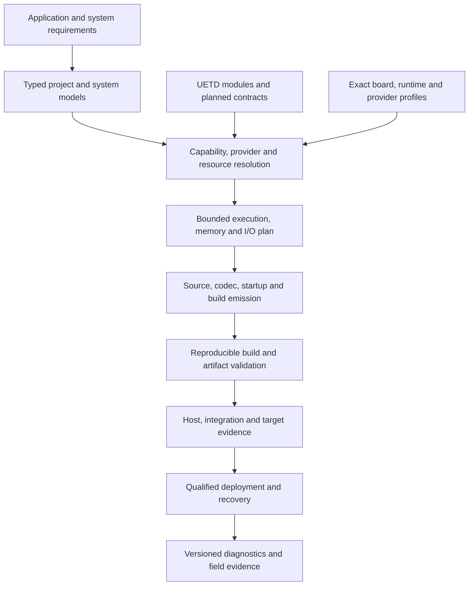

# Complete embedded system design

Design baseline: 29 October 2026. [First-pass scope and completed placement migration](FIRST_PASS_SCOPE.md) distinguish priority from implementation readiness. This is an implementation blueprint. The
contracts and schemas in this design do not enable generation or qualify a
target. Current implementation evidence is recorded in the
[critical catalogue audit](../../audits/UETD_CRITICAL_CATALOGUE_AUDIT_2026-10-29.md).

## Product boundary

UETD should assemble inspectable MCU and embedded-SoC firmware for bare-metal
and qualified RTOS environments. It should cover control products, battery
devices, instruments, connected sensors, industrial nodes, gateways and
touchscreen handheld controls, with optional audio/imaging/inference providers.
Systems may contain several independently deployed nodes, multiple cores,
and externally implemented PLC/FPGA/application-processor endpoints.

Completeness means a supported application has a declared route from its
requirements to source, resources, build, deployment, observation, and recovery.
It does not mean implementing every vendor driver or protocol inside UETD.
An external implementation with a bounded, pinned, tested UETD adapter is a
valid capability. An unresolved provider is a generation blocker.

The initial product does not generate Linux distributions, arbitrary FPGA RTL,
RF PHYs/basebands, vendor ROMs, GPU stacks, browser engines, or clinical/safety
certification. Such systems can be external endpoints. Advanced medical,
aviation, automotive, and power-stage models require an application-specific
profile and evidence; a catalogue name does not supply that model.

## Documents and authority

| Design | Owns |
|---|---|
| [Foundations, hardware and runtime](FOUNDATIONS.md) | Common execution contract; target resources; DMA, power, time, peripheral transactions, UOS and intercore execution |
| [Product and data services](PRODUCT_SERVICES.md) | Sensors, actuators, storage, configuration, events, lifecycle, observability, UI, audio and inference |
| [MIPI display link](MIPI_DISPLAY_LINK.md) | First-pass DSI/DSI-2 host, DCS/panel and hardware-backed D-PHY/C-PHY provider requirements |
| [Connectivity and security](CONNECTIVITY_SECURITY.md) | Transport/stack boundaries, protocols, provisioning, identity, cryptography, commissioning, boot/update and maintenance |
| [Math and control](MATH_CONTROL.md) | Numerical contracts; every existing UMATH/UCON family; typed algorithm state; solver and application-model policies |
| [Generation and qualification](GENERATION_QUALIFICATION.md) | Source-to-image pipeline, provider lock, resource proofs, generated scheduling, deployment, tests, acceptance projects and release evidence |
| [Myovena handheld specifics](MYOVENA_HANDHELD.md) | First-pass approximately 7-inch OLED touchscreen, generic display driver, graphics/input/UI, BLE/WiFi product control and hardware-selection requirements |

The owning C header remains authoritative for the **current** API. Proposed
signatures in these documents describe a future revision and do not silently
change that ABI. Existing [UOS contracts](../UOS_CONTRACTS.md),
[application FSM design](../UAPP_STATE_MACHINE_DESIGN.md),
[multicore/system plan](../../../../docs/roadmap/MULTI_TARGET_AND_MULTICORE_PLAN.md),
[connectivity plan](../../roadmap/CONNECTIVITY_STACK_AND_ARTIFACT_PLAN.md), and
future storage/update/evidence schemas remain owners of their detailed work.
This design supplies cross-layer constraints and missing families. A conflict
must be resolved in the owning contract before promotion; two competing
runtime definitions must not be generated.

The main module catalogue owns first-pass runtime requirements, including
explicitly blocked design contracts where source does not exist yet. First-pass
host/compiler/deployment requirements are specified in the generation design;
its proposed capability catalogue remains implementation work. The future catalogue owns genuinely later scope. The [placement record](FIRST_PASS_SCOPE.md) documents the completed first-pass migration. Priority and implementation
readiness are independent: an unfinished foundation belongs in the first pass,
and a design entry never becomes selectable merely because it moved out of
`future/`.

## Architectural decisions

1. **Operation-level support.** Separate source implementation, reviewed C
   contract, language binding, emitter support, provider support, target build,
   and hardware evidence. Support is the intersection for the exact selected
   operations and configuration. Neither `scaffold_only: false` nor a CMake
   archive proves this intersection.
2. **Portable policy, explicit providers.** UETD owns service state machines,
   validation, typed interfaces, and generation. Silicon operations, third-party
   stacks, licensed libraries, radio/controller blobs, and bootloaders enter
   through explicit provider contracts. Reference adapters are maintained for
   a small qualified target set before broad family expansion.
3. **Static by default.** Configurations resolve dimensions, task stacks, pools,
   queues, packet limits, journals, solver iterations, and resource budgets at
   generation. An external stack that allocates must declare its capped arena,
   fragmentation/lifetime policy and failure behavior; it cannot claim the
   static profile by hiding allocations behind an adapter.
4. **One owner per mutable object.** Tasks communicate through explicitly chosen
   snapshots, mailboxes, queues, or streams. ISR ingress is bounded and separate
   from service processing. A remote operation is an asynchronous message,
   never an implicit C call or pointer transfer.
5. **Qualified failure behavior.** Every output declares what happens on stale,
   invalid, missing, cancelled and failed input. Local hardware owns its safe
   state. Communication retries and a supervisory callback do not substitute
   for a local output inhibit.
6. **Inspectable generation.** Generated C, startup, linker scripts, SDK
   configuration, source maps, lockfiles, budget reports, and validation results
   are ordinary reviewable artifacts. Handwritten code is integrated through a
   declared module boundary rather than pasted into regenerated files.
7. **No invented universal wire protocol.** Standard protocols retain their own
   encoding. Project protocols declare their encoding once. UETD internal
   descriptors/hashes identify build artifacts; they do not insert a handshake
   into a peer protocol unless that protocol explicitly defines it.
8. **No blanket real-time claim.** Static loop bounds, measured execution time,
   response-time analysis, and hard WCET proofs are distinct evidence types.
   Unknown costs remain unknown and block a requested guarantee.

## Coverage tiers and priorities

Priority expresses implementation order. Tier expresses the intended support
boundary; neither grants implementation readiness.

| Tier | Expected coverage | Release gate |
|---|---|---|
| Foundation | Errors/time, ownership, resource graph, startup, basic I/O, static execution, numeric primitives, diagnostics, typed C emission | At least two exact targets with different relevant architectural constraints; host contracts and physical smoke evidence |
| General product | Persistence/configuration, sensor/actuator lifecycle, USB console, Ethernet/IP and selected wireless providers, secure maintenance, power-aware operation, and the Myovena handheld display/touch/UI path | Each claimed product composition builds, runs, loses power/links safely, and reports bounded behavior |
| Optional later packs | Specialized industrial profiles, cellular/LPWAN, mesh, audio, imaging, inference and specialized motion/instrumentation | Named subset and pinned provider, explicit memory/timing/resource limits, pack-specific interoperability tests |
| Research/profile required | Advanced control/estimation, proprietary industrial/medical profiles, unusual silicon, hard determinism or assurance claims | Plant/protocol/target model and validation obligations resolved before implementation promotion |

Foundation work precedes additional catalogue breadth. First-pass graphics and
networking remain optional per project, so they do not burden small control targets.
The resolver includes only selected modules and their actual dependency
closure. A minimum-profile project must not link TLS, graphics, networking,
or advanced solvers merely because their design exists.

## Shared contract checklist

Every design item must settle the following before becoming an implementation
task with a generation route:

| Contract field | Required answer |
|---|---|
| Identity | Owner, version, supported operation/profile subset and compatibility policy |
| API | Typed configuration/state, inputs/results, units/frames and valid ranges |
| Execution | Owner, allowed contexts, poll/async/blocking behavior, maximum work per call |
| Lifetime | Buffer ownership, borrow/copy/retain rules, completion and cancellation |
| Resources | Persistent/scratch/stack memory, queue/pool limits, pins/clocks/DMA/IRQs/partitions |
| Time | Clock domain, timestamps, maximum age, deadline and suspend behavior |
| Failure | Status distinctions, state/output commit rules, recovery and safe action |
| Generation | Authoring fields, resource checks, selected provider, emitted artifacts |
| Evidence | Independent reference tests, adversarial cases, target/interoperability tests and scope |

Design metadata records unresolved profiles explicitly. “Specified” means the
common contract is defined here; it does not mean every numeric parameter,
plant, protocol subset, or board has been chosen.

## Implementation sequence

1. Reconcile the current source/metadata defects and automate catalogue checks.
   Stabilize deadlines, statuses, ABI, operation ownership and provider contracts.
2. Implement a thin usable vertical path on at least two exact boards: startup,
   time, GPIO, serial, timer/ADC/DMA, watchdog, runtime, generated application,
   build, deployment and logs. Choose targets after the portable capability
   inventory; do not treat one demonstration board as universal qualification.
3. Complete the widely reused portable pieces: bounded queues/events, sensor
   snapshots, configuration/persistence, codecs, common filters/estimators,
   numeric solves and recovery. Expose their typed language contracts.
4. Add power-aware data logging and connected-device compositions with selected
   storage, network, provisioning and secure-update providers.
5. Add industrial and optional domain packs through the same provider and
   resource model. Qualify shared-core/channel and multi-node compositions.
6. Expand advanced algorithms and targets by demonstrated use. Keep undefined
   medical/plant/protocol profiles blocked while their common infrastructure
   remains reusable.

The [generation design](GENERATION_QUALIFICATION.md#acceptance-projects) defines
the acceptance projects and exit gates. The implementation backlog must carry
dependencies and evidence, not an estimated percentage inferred from file count.
