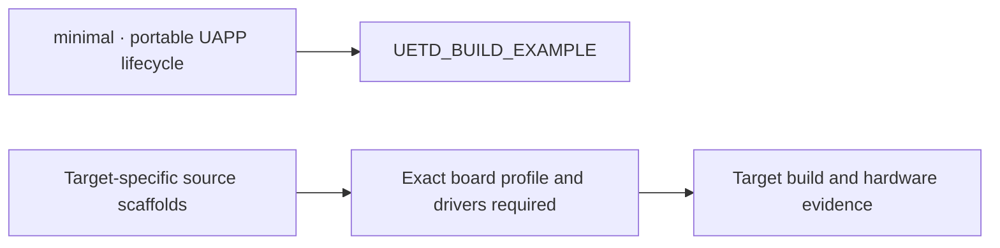

# UETD examples

UETD includes one portable lifecycle example and nine target-oriented source
scaffolds. Only `minimal` is wired to the CMake option
`UETD_BUILD_EXAMPLE`; the hardware examples are reference starting points and
are not built by default or qualified for physical hardware.

| Example | Demonstrates | Current status |
|---|---|---|
| [minimal](minimal/README.md) | UAPP component lifecycle without peripherals | Built by CMake when `UETD_BUILD_EXAMPLE=ON` |
| [baremetal_minimal](baremetal_minimal/README.md) | GPIO initialization and bounded application loop | Source scaffold; board clock, GPIO mapping, and safe error path are unspecified |
| [uart_dma_rx](uart_dma_rx/README.md) | UART receive buffer and DMA/IDLE path | Source scaffold; target DMA, cache, interrupt, and buffer ownership are unspecified |
| [spi_imu](spi_imu/README.md) | SPI-connected IMU and calibrated samples | Source scaffold; device, register map, timing, and calibration are unspecified |
| [adc_hrtim_triggered](adc_hrtim_triggered/README.md) | HRTIM-triggered ADC sampling | Source scaffold; trigger, channels, clock, DMA, and shutdown behavior are unspecified |
| [freertos_tasks](freertos_tasks/README.md) | Statically allocated UOS task setup | Source scaffold; selected port, stacks, priorities, and synchronization are unspecified |
| [crsf_receiver](crsf_receiver/README.md) | CRSF frame decoding and receiver freshness | Source scaffold; UART configuration, bounded buffering, and failsafe policy are unspecified |
| [dshot_motor](dshot_motor/README.md) | DSHOT transport and motor command path | Source scaffold; timer/DMA timing, pin polarity, arming, and failsafe behavior are unspecified |
| [can_dronecan](can_dronecan/README.md) | CAN-based DroneCAN/UAVCAN node | Source scaffold; CAN controller, stack binding, node identity, and recovery are unspecified |
| [full_motor_control](full_motor_control/README.md) | Sensing, control, communication, and actuator composition | Source scaffold; complete components, timing budget, arming, and safe states are unspecified |

The individual READMEs describe each example's intended scope and integration
requirements. For supported CMake options and the portable lifecycle example,
see the [UETD build and API guide](../README.md#build).
