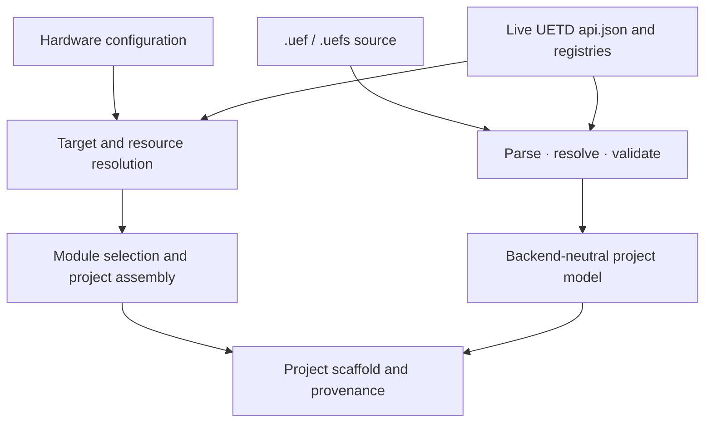

# uef-gen

`uef-gen` is the host-side project assembler for UETD-based embedded firmware. It validates hardware configuration, resolves target resources, selects UETD modules, writes a structured project scaffold, and records build inputs and provenance. It is a Python tool; generated firmware does not require Python at runtime.


## Ownership

- **UETD** owns reusable embedded source, public headers, module/API metadata, the UMATH mathematical foundation and catalogue, control algorithms, protocol APIs, and reusable templates.
- **uef-gen** owns hardware/resource resolution, module selection, hardware-configuration project assembly, the standalone `.uef` compiler and intermediate model, and adapters for UETD registries and snapshots.

`uef-gen` reads registry paths and metadata from the live UETD checkout. It does
not bundle a UETD source snapshot or maintain a duplicate target database. The
generator resolves selected module dependencies and records the inputs and
manual actions associated with the project scaffold. Missing hardware data is
reported; it is not inferred.



## License

UETD and `uef-gen` together make up the Unified Embedded Framework and are
licensed under GNU GPL-3.0-only; see the repository [LICENSE.md](../LICENSE.md).
Dependencies retain their own license terms. The VS Code extension is part of
this project and uses the same GPL-3.0-only license.

## Requirements and installation

- Python 3.11 or newer
- PyYAML and jsonschema (installed as package dependencies)
- Jinja2 for the optional UETD template-rendering helpers; install the `templates` extra

From the UEF repository root, install the generator and optional template helpers:

```powershell
Push-Location .\uef-gen
python -m pip install -e ".[templates]"
Pop-Location
```

## Locating UETD

At generation time the locator checks, in order:

1. `UETD_PATH`
2. `uetd.path` in the hardware configuration
3. `../UETD`, `../../UETD`, and `./UETD`, relative to the configuration/project directory

The located checkout must contain `api.json` and every registry index and detail manifest declared by that contract. `api.json` is the canonical UETD version and discovery contract; a legacy `version.json` is optional and, when present, is checked for consistency. Every selectable module declares its source files and public-header closure; generation copies only those files for the resolved module dependency closure. The source fingerprint covers the live registry/detail trees. Generated provenance includes the indexes and referenced detail files. No copy of UETD is packaged in the Python wheel.

UETD also declares a separate future-catalogue index for accepted design work.
`uef_gen.uetd_adapter.registry.load_future_catalogue()` validates that index and resolves
its linked UETD or repository-owned contract documents. Those entries are
planning data only and never join the selectable module closure.

For example, when `UETD/` and `uef-gen/` are sibling folders:

```powershell
$env:UETD_PATH = (Resolve-Path .\UETD).Path
```

Alternatively, set `uetd.path` in the project YAML:

```yaml
uetd:
  path: ../UETD
```

## Project language

The standalone authoring path is described in
[project language design](../docs/design/PROJECT_LANGUAGE_DESIGN.md). It describes
hardware, sensors, actuators, protocols, dynamic-system models, UETD-native and
custom mathematical algorithms, language-owned hybrid compositions, typed
subsystem contracts, and an `operatingsystem` root containing tasks and
optional tasksets. A `.uefs` source composes multiple target projects and their
typed links. The `.uef` and `.uefs` lexer, parser, registry resolution,
semantic checks, editor analysis, and backend-neutral lowering are
implemented. Eight of the ten current `.uef` examples pass frontend
validation. The ESP32 sorter uses an unregistered `stepper` descriptor. The
H745 Tesla-coil design has unresolved plant dimensions/equations and two
controller inputs, so its `.uef` and importing `.uefs` report expected design
errors. Warnings for incomplete UETD
authoring/generation contracts remain visible. No firmware emitter consumes
the lowered application or system plans yet. `check` runs the frontend; `.uef
generate --dry-run` can validate and resolve a project, while publishing
generated firmware from `.uef` or `.uefs` remains unavailable. Build, flash,
probe discovery, and wired monitoring are unavailable. See
[UEF-PL user handbook](../docs/guides/UEF_PROJECT_LANGUAGE_HANDBOOK.md) for a
first-time walkthrough, the
[technical language guide](../docs/guides/UEF_PROJECT_LANGUAGE_GUIDE.md) for
the source rules, and the
[generated catalogue](../docs/reference/UEF_PROJECT_LANGUAGE_CATALOGUE.md) for
the registered module/type/UMATH names. The
[unit reference](../docs/reference/UEF_PL_UNITS_REFERENCE.md) groups units by
dimension. The
[language audit](docs/audits/LANGUAGE_AUDIT.md) records current coverage and
implementation gates. The
[`src/uef_gen/language/registry/README.md`](src/uef_gen/language/registry/README.md)
explains how to extend syntax without duplicating UETD catalogue data. Custom
algorithm equations are parsed and checked as bounded DSL expressions, not
copied C/Python source. Parser and checker coverage still needs work, and the
backend that emits those constructs has not been implemented.

The `.uef` and `.uefs` command routes are present but do not yet form a full
firmware workflow. Use `check` to see current frontend diagnostics. `.uef
generate --dry-run` validates and resolves the source; generation to firmware
files is unavailable. `build` and `flash` are explicit unavailable
scaffolds:

~~~powershell
uef-gen check .\examples\showcases\stm32f722_drone_controller.uef
uef-gen generate .\examples\showcases\stm32f722_drone_controller.uef
uef-gen build .\examples\showcases\stm32f722_drone_controller.uef
uef-gen flash .\examples\showcases\stm32f722_drone_controller.uef
~~~

The example index at [`examples/README.md`](examples/README.md) groups the
basics, platform bindings, and domain showcases. The ECHO acoustic observatory
is the broadest multi-node processing sketch; the drone remains the source
comparison control baseline. The Tesla-coil
examples show the H745 controller, STM32G474VET6 executor/protection node,
MCU-side FPGA protocol contract, and multi-target `.uefs` composition.
For a first-time walkthrough, see the
[UEF-PL user handbook](../docs/guides/UEF_PROJECT_LANGUAGE_HANDBOOK.md).
For language rules, see the
[technical guide](../docs/guides/UEF_PROJECT_LANGUAGE_GUIDE.md); for the JSON
ownership and discovery flow, see
[UEF-PL registries and discovery](../docs/guides/UEF_PL_REGISTRIES.md).
For editor support, see the [shared editor overview](editors/README.md), the
[VS Code extension README](editors/vscode/README.md), and the
[Visual Studio VSIX scaffold](editors/visual-studio/README.md). Both editor
clients are designed to use the same UEF-PL language server. The VSIX targets
the Visual Studio 17.x API family for Visual Studio 2022 and 2026. A local
VSIX build and experimental-instance highlighting have been confirmed; release
packaging and the IDE-version compatibility matrix still need validation. The
shared server provides compiler diagnostics, registry-backed completion/hover,
signature help, and limited definition navigation. Parser and semantic
coverage is incomplete, and project-local navigation is not comprehensive.

## Commands

Validate target/resource configuration:

```powershell
uef-gen validate .\path\to\hardware.yaml
```

Resolve the selected module closure without writing a project:

```powershell
uef-gen generate .\path\to\hardware.yaml --output .\build\firmware --dry-run
```

The hardware-configuration path can validate records and assemble a project
scaffold, but it does not produce a verified build or flash-ready firmware.
The standalone frontend can check and dry-run `.uef` sources; its emitter,
build, and flash paths remain unfinished.

Inspection commands include targets list, targets list --include-scaffolds --uetd PATH, targets show <chip> --uetd PATH, modules list/show, snapshot verify, and version. The target listing reads UETD-owned family and chip registries at runtime. Each chip record is materialized into the resolver, but physical records remain blocked for generation until their resource maps and a selected board's build/flash profile are ready. See `../UETD/registry/targets/README.md` for the concise chip and board authoring workflow.

### V1 diagnostics and live output

V1 is intended to provide readable command-line diagnostics and live text output from firmware that is already running on a target connected by cable. The wired console interface and its settings will come from the selected development-board record in UETD. The current CLI emits JSON command responses; a polished human-readable mode is unfinished. The monitor command is a fail-closed scaffold and does not open a serial port. Wireless transports are deferred to a later version.

## Generated project and current limits

Generated output includes selected UETD files under `uetd/`, pinned UETD-managed dependency files under their declared project-local roots, application/config/board/target scaffolding, canonical `project_*.txt` source/include/define/compiler/link lists, optional Make/CMake fragments, and JSON provenance under `manifest/`. `manifest/manual_actions.json` lists path-qualified driver, protocol, board, and other work declared by UETD; matching actions also appear as warnings in the response. The generated startup and linker files are placeholders until a verified target profile supplies real values.

Generated projects copy selected modules' source files and declared
transitive public-header closure, so unrelated UETD APIs are not staged. The
generic PID and lead-lag C implementations can also be used directly through
their public headers. Other algorithm and protocol catalogue entries remain
scaffolds; module/template presence does not mean behavior or target support is
ready. The module selector blocks entries marked `scaffold_only`.

The family roadmap is owned by UETD at `registry/targets/families/registry.json`, with
one file per family under `registry/targets/families/manifest/`. Exact-part chip
records are indexed at `registry/targets/chips/registry.json`; development
boards are indexed at `registry/targets/development_boards/registry.json`.
`api.json` is the locator contract for all three. The family catalogue still
includes six Phase 0 profiles, the Phase 1 SDMMC target families STM32H7/F7/L4+
(L4+ is a new scaffold), later Part XV targets, and broader STM32/Espressif
series coverage. Use `uef-gen targets list --include-scaffolds` to inspect it;
pass `--uetd PATH` when the UETD checkout is outside `UETD_PATH` or documented
relative paths. Chip records are real resolver inputs, while generation stays
fail-closed per chip and development board until their data is complete.

For FreeRTOS, UETD owns the source package and exact pin/profile metadata. `uef-gen` never downloads dependencies: generation fails with a path-specific diagnostic until the locked checkout, license text files, and a matching architecture/compiler profile are present. The selected kernel sources, headers, license files, and revision/profile provenance are copied into the generated project. FatFS remains an explicitly consumer-supplied optional dependency.

The sample target data is not verified for physical hardware. Project assembly does not mean the output is ready to flash. Build, artifact verification, physical target discovery, and deployment remain incomplete; inspect [`TODO.md`](docs/TODO.md) before relying on those paths.

See the [maintainer architecture notes](docs/ARCHITECTURE.md) for the source map and ownership boundaries. The [implementation inventory](docs/TODO.md) and [cross-project implementation plan](../docs/roadmap/IMPLEMENTATION_PLAN.md) are maintainer worklists.
