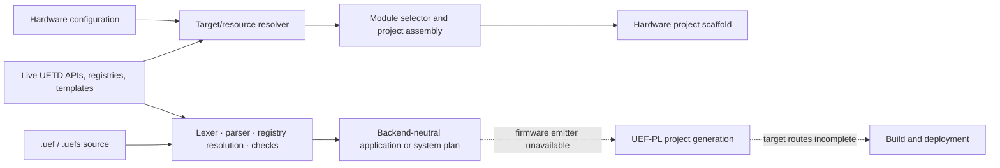

# uef-gen documentation

The [uef-gen README](../README.md) is the entry point for installation, CLI
usage, project assembly, and the boundary with UETD. This directory holds the
source map and implementation planning documents.

UETD and uef-gen are licensed together under GPL-3.0-only; see the repository
[`LICENSE.md`](../../LICENSE.md). Third-party components retain their own terms.

For people authoring standalone `.uef` projects, the official starting point is
the [UEF-PL user handbook](../../docs/guides/UEF_PROJECT_LANGUAGE_HANDBOOK.md).
The [technical guide](../../docs/guides/UEF_PROJECT_LANGUAGE_GUIDE.md) covers
language semantics; the [registries and discovery guide](../../docs/guides/UEF_PL_REGISTRIES.md)
explains how UETD JSON catalogues feed the language.

- [Architecture](ARCHITECTURE.md) explains package ownership, the UETD API
  boundary, generation pipeline, and artifact provenance.
- [Implementation inventory](TODO.md) tracks unfinished features and known
  limitations.
- [Language audit](audits/LANGUAGE_AUDIT.md) records the standalone language
  frontend's current scope and implementation gates.

Focused READMEs remain beside schemas, editors, language registries, target
resolvers, and deployment code. The example catalogue is at
[`../examples/README.md`](../examples/README.md).
