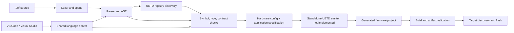

# UEF-PL Frontend and Backend: Architecture and Working Order

This guide describes the code that exists today and the order for completing the standalone firmware backend. It is an architecture guide, not a source-file TODO list. The parser, semantic frontend, `.uefs` composition frontend, and editor connection are implemented as working compiler paths. The firmware emitter, generated-project validation, build, flash, and wired monitor paths are separate unfinished capabilities.

## 1. The compiler boundary

UEF-PL is a declarative, bounded project language. The compiler reads it as data; it never runs embedded Python, C, or C++. The essential flow is:

There are three useful representations:

1. **Source AST:** retains authored names, order, and source spans.
2. **Validated application specification:** retains resolved module identities, types, values, runtime structure, contracts, and source provenance in backend-neutral data.
3. **Generated firmware project:** contains selected UETD source/template output plus application glue and build metadata. This is the next major implementation boundary.

The CLI and language server share the compiler APIs. Editor behavior must never introduce a second parser or semantic rule set.

## 2. Where the working frontend lives

A saved `.uef` follows the same path as an in-memory editor document: lexer → parser → safe imports and registry load → symbol/type validation → lowering. A compilation result is successful only when both the hardware configuration and the application specification exist and there are no error diagnostics.

On success, `uef-gen check project.uef` returns the complete `backend_input` object as JSON: resolved hardware configuration, the typed application specification, UETD root identity, and source-map provenance. The DSL frontend therefore hands a complete structured design to a future emitter without making the CLI depend on YAML, NEXUS, or a second project parser. `generate` still stops at the emitter boundary below.

## 3. Registry and import ownership

UETD is the source of truth for chip/board targets, runtimes, modules, public types, units, UMATH declarations, and module authoring/generation contracts. `api.json` links the registry files. `uef-gen` loads those files through the UETD locator and registry adapters; it does not maintain a parallel target or component catalogue.

`src/uef_gen/language/registry/registry.json` owns syntax and language-only constructs such as `map`, `select`, `match`, and generic language types. It does not duplicate UETD module/type/target names. The TextMate grammar supplies colors only; the compiler and LSP own validity and diagnostics.

A `.uef` may import one `.uefs` contract with `contract import "relative.uefs";`. The import resolves relative to that `.uef`, is parsed as data, and exposes only shared declarations and endpoint facts for the matching node. It does not compile sibling projects or create remote function calls. `.uefs` uses its own syntax registry but reads UETD-owned target and module facts from the same API-linked catalogues.

## 4. Types and expression checking

`type_interchange.py` is the single home for value-type resolution. It combines four namespaces without flattening away ownership:

- language-owned values and constructors such as `bool`, `Received<T>`, `Option<T>`, `Result<T,E>`, `Bytes[N]`, and `Utf8[N]`;
- project-owned records, enums, variants, flags, and fixed-point types;
- types explicitly imported from a `.uefs` system contract;
- UETD public types whose registry metadata authorizes their use in the current context.

A UETD header declaration or completion item alone does not make a C type a legal DSL value. C names, `umath_*` symbols, pointers, and inferred C struct layouts are not the language type system. Units and UMATH function signatures resolve through UETD registries. The type checker rejects implicit numeric, unit, shape, enum, and boundary conversions.

A language construct is implemented only when source syntax is retained in the AST, the semantic rule rejects invalid inputs, lowering preserves its data, the editor uses the same registry/compiler facts, and the selected backend supports its target representation. Current lowering descriptors are backend inputs; they do not promise generated C for every type or boundary. See [`TYPE_INTERCHANGE.md`](../src/uef_gen/language/frontends/project/TYPE_INTERCHANGE.md) for the cross-boundary contract.

Hybrid `choose` branches are retained as ordered condition/value pairs. The checker requires declared outputs to be assigned, checks branch conditions and results against their output types, and rejects forward reads from later stages or locals. Subsystems and hybrids both validate named member inputs, source order, and output assignments. UMATH names are permitted only in custom algorithm and model implementation expressions; each accepted call carries its exact UETD registry binding route into the backend input. The variant manifest deliberately leaves payload size and alignment unresolved until a target ABI backend can prove them.

## 5. `.uefs` compiler path

`src/uef_gen/language/frontends/system/` owns multi-target system composition:

1. `parser.py` reads system declarations and source-located node/link contracts.
2. `validation.py` checks target and project paths, shared types, protocols, external endpoints, link direction, endpoint contracts, and system hybrid relationships.
3. `compiler.py` compiles each referenced `.uef` using the public project compiler API.
4. `lowering.py` creates a deterministic plan only when every declared node and link compiles successfully.

`uef-gen check file.uefs` exercises that full path. `uef-gen generate file.uefs` currently rejects the plan because there is no system firmware emitter. A build plan is not a set of binaries and cannot be flashed.

## 6. Editor positions and language services

The lexer records source columns as Python Unicode code points. The LSP protocol uses UTF-16 character offsets for the default Visual Studio and VS Code client encoding. `src/uef_gen/language/server/server.py` converts incoming UTF-16 cursor positions into code-point offsets for context-sensitive hints and converts compiler spans back to UTF-16 for diagnostics and navigation. Keep that conversion at the LSP boundary; do not make the lexer editor-dependent.

The VS Code TextMate grammar is also included by the Visual Studio VSIX project, so update `editors/vscode/syntaxes/uef.tmLanguage.json` for `.uef` coloring and `uefs.tmLanguage.json` for `.uefs` coloring. Grammar scopes affect colors only. Completions, hovers, signatures, definition locations, and diagnostics come from the Python LSP server and live registries.

## 7. Remaining implementation order: standalone firmware backend

The next concrete coding task is to make `generate .uef` consume `CompilationResult.application_spec` rather than stopping after validation. Keep this work in a backend module; do not put C rendering into the parser, type checker, or `cli.py`.

2. **Resolve the selected UETD routes.** Reuse `registry_contracts.py`, module selection, template/source closure, and target capability data. Before rendering, verify every module, type, UMATH call, runtime behavior, codec, and target route has a generation contract. Missing routes stop before output files are published.
3. **Render one backend-neutral application model.** Convert records, state machines, schedules, model equations, algorithms, subsystem/hybrid stages, protocol layouts, and component settings into the UETD-owned template inputs. Preserve source order only where the language makes it meaningful. All arrays, buffers, loops, work areas, and scratch storage remain bounded.
4. **Validate the generated project.** Run the existing UETD generated-project checks and compare selected source closure against the resolved manifest. Keep generated-file-to-source spans so diagnostics can point back to `.uef` declarations.
5. **Wire CLI generation to that backend.** `check` stays frontend-only. `generate` produces and validates a project directory. `build` compiles it with a pinned toolchain. Build artifacts record source, registry, template, and compiler identities.
6. **Add deployment as a separate stage.** `flash` accepts only a verified artifact, resolves a real target/probe, reports the selected chip/board, and verifies programming. Wired runtime output is a separate monitor command and must not flash or reset firmware implicitly.
7. **Add `.uefs` generation after the node backend works.** Consume the validated `SystemBuildPlan`, generate each node independently, then validate cross-node transport configuration and deployment order. Do not turn system links into local calls.

The repository already makes the unsupported boundary explicit: `generate .uef` and `generate .uefs` return a stable backend-unavailable diagnostic after successful checking. That is the current starting point for backend work; the frontend files listed above are not a sequence of unimplemented TODO stubs. A project that currently fails semantic checking must first be reconciled with its actual UETD authoring contracts and registered types; the compiler reports those as source or registry diagnostics and does not emit a partial backend input.
