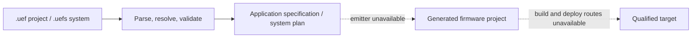

# UEF Project Language implementation status

UEF Project Language (UEF-PL) is an implemented, standalone source frontend
for describing UETD applications. The lexer, parser, registry resolution,
semantic checks, editor analysis, and backend-neutral lowering are in place.
The remaining generation work is the firmware emitter and its target-specific
build and deployment routes.

## Pipeline status

| Stage | Current state |
|---|---|
| `.uef` project and `.uefs` system parsing | Implemented with source-located diagnostics. |
| UETD registry discovery | Implemented through `api.json`, catalogue indexes, and referenced manifests. |
| Semantic validation | Implemented for supported declarations, types, units, expressions, component contracts, resources, and system links. Incomplete or scaffold-only UETD capabilities remain blocked. |
| Lowering | Implemented into a backend-neutral application specification or multi-target build plan. |
| Firmware emission | Unavailable. No emitter consumes the lowered application or system plan. |
| Build and flash | Unavailable for UEF-PL projects because there are no emitted firmware files or qualified target routes. |
| Hardware qualification | Not established by source examples or frontend validation. |

`uef-gen check <file>` runs the frontend. `uef-gen generate <file> --dry-run`
validates and resolves the source without publishing firmware. A normal
language-project generation request reports that its backend is unavailable.
This path is separate from hardware-configuration generation, which can resolve
registries and assemble a project scaffold without producing a verified build.

## Ownership and readiness

UETD owns target, board, runtime, module, type, unit, UMATH, authoring, and
generation contracts. `uef-gen` owns the language grammar, compiler frontend,
and lowering. A registered name is not sufficient for use: its UETD contract,
implementation, target binding, and generation route must also be ready.

`.uef` describes one target project. `.uefs` groups target projects and their
typed communication links while leaving each node independently built. Neither
format embeds Python or C/C++ source. Project expressions are parsed as typed
language constructs and are not evaluated as arbitrary host code.

The current limits are concentrated after frontend lowering: the emitter must
map application and runtime contracts into UETD templates, the system route
must emit each qualified node and link configuration, and build/flash need
exact target toolchain and deployment profiles. Example projects remain design
references until those routes and their selected capabilities are complete.

## Source and documentation map

- [User handbook](../../../docs/guides/UEF_PROJECT_LANGUAGE_HANDBOOK.md) —
  source structure, commands, examples, and registry ownership.
- [Technical language guide](../../../docs/guides/UEF_PROJECT_LANGUAGE_GUIDE.md) —
  types, expressions, operating-system declarations, and system files.
- [Language design](../../../docs/design/PROJECT_LANGUAGE_DESIGN.md) —
  detailed source and lowering contracts.
- [uef-gen implementation inventory](../TODO.md) — remaining compiler and
  target-generation work.
- `../../src/uef_gen/language/frontends/project/` — project lexer, parser,
  checker, and lowering.
- `../../src/uef_gen/language/frontends/system/` — `.uefs` parser, checker,
  and system-plan lowering.
