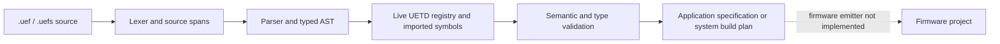

# UEF Project Language compiler

UEF-PL is the standalone, typed project language for describing a complete UETD application. Its public compiler frontend is implemented: it tokenizes and parses `.uef` source, loads the live UETD registries, checks project and system contracts, reports source-located diagnostics, and lowers valid source into a hardware configuration plus a backend-neutral application specification.

The firmware emitter is a separate incomplete stage. `uef-gen check` exercises the frontend. `uef-gen generate <file>.uef` currently stops with an explicit backend-unavailable diagnostic after successful checking because the existing renderer does not consume the lowered application specification. `.uefs` checking also produces a deterministic multi-target plan, but there is not yet a firmware emitter for that plan. Build, flash, and wired-monitor operations remain unavailable for these language projects.

For a first-time language walkthrough, read the [UEF-PL user handbook](../../../../../../docs/guides/UEF_PROJECT_LANGUAGE_HANDBOOK.md). Read [the language design](../../../../../../docs/design/PROJECT_LANGUAGE_DESIGN.md) for compiler contracts and multi-target semantics, and the [technical guide](../../../../../../docs/guides/UEF_PROJECT_LANGUAGE_GUIDE.md) for syntax and value rules. The [generated catalogue](../../../../../../docs/reference/UEF_PROJECT_LANGUAGE_CATALOGUE.md) and [unit reference](../../../../../../docs/reference/UEF_PL_UNITS_REFERENCE.md) are derived from UETD's registries.

## Compiler flow

State-machine declarations are validated and lowered as design data, but they
are not executable firmware yet. Each machine names one scheduled owner and
its task consumers. The owner alone initializes and evaluates it; other tasks
receive independent read-only state snapshots. UEF-PL uses ordered guards and
`any` sources, while UETD's C API consumes event IDs and exact source states.
The required adapter contract is one synthetic tick event per owner activation,
`any` expansion to exact source rows, synchronized RTOS ingress, bounded
per-consumer delivery, and callback-status fault propagation.

The CLI and language server share the same compiler APIs. The LSP adapter translates internal code-point columns to UTF-16 positions at the editor boundary; the lexer, parser, and validators remain editor-independent.

## Single-target source structure

A `.uef` project places declarations in this order:

1. Project name, exact target ID, optional `.uefs` contract import, numeric profile, project parameters, records/enums, and component constructor declarations.
2. One `operatingsystem` block that declares runtime modes and scheduled work.
3. One `implementation` block containing hardware settings, model/algorithm/protocol details, and component bodies.

Role forms include `sensor imu : imu;`, `algorithm rate : pid;`, `subsystem controller;`, and `hybrid algorithm robust_controller;`. Other directly authorable modules use their unique UETD `DSL_descriptor`, such as `watchdog safety_timer;` or `fpga coil_link;`. There is no generic `component` declaration.

Each UETD-backed definition repeats its selected descriptor immediately after
the closing brace: `algorithm rate { ... } pid;` or
`watchdog safety_timer { ... } watchdog;`. The suffix must exactly match the
descriptor on the constructor declaration, making the implementation's UETD
module visible at the point of use. Project-defined `custom algorithm`,
`custom protocol`, `model`, `hybrid algorithm`, and `subsystem` definitions do
not take a UETD suffix.

## Composition and type model

- `record` and fixed-width `enum` declarations provide project-owned nominal data types.
- `subsystem` declarations expose typed ports and call aliased members in explicit source order through `stage` statements. Membership does not imply execution.
- `hybrid algorithm` declarations compose declared algorithm instances with ordered stages, bounded selection, and explicit output/failure contracts.
- `custom algorithm` bodies use a bounded, side-effect-controlled expression subset. Registered UMATH calls are discoverable by their UETD `dsl_name` and are accepted only where the language permits them and the UETD binding is ready.
- `model` declarations preserve matrices, equations, Jacobians, and explicit discretization details in the application specification.
- `project routine` declarations provide explicit zero-argument callback contracts for project-owned hooks; state-machine hooks must say `returns status` so failure reaches the UETD FSM fault latch. They remain separate from UETD module operations and are retained in backend input. The default context is `task`; `context = isr_signal_only` is required for project routines called from an interrupt.
- `custom protocol` declarations describe bounded message layouts and encoding contracts; they do not implement hardware drivers or FPGA RTL.
- The type interchange layer resolves project and imported types alongside API-linked UETD types, units, and UMATH signatures. `Option<T>`, `Result<T,E>`, project variants, flags, fixed-point types, and bounded byte/text types have parser/type/lowering representations. A lowered descriptor is not proof that a selected target has a generated C representation; unsupported generation routes must remain blocked.

The standalone source is parsed as data. Expressions become AST nodes; source text is never passed to Python evaluation or treated as embedded C/C++.

## Operating-system semantics

`operatingsystem` owns runtime selection, state machines, tasks, interrupts, channels, resources, and timing constraints. It requires one `component_failure_policy` for task, loop, and FSM callback failures. Tasks describe one typed component invocation. Channels name one producer and a `consumers = [task_a, task_b]` list; each consumer receives an independent bounded FIFO mailbox, so one receiver cannot steal another receiver's message. A component input destination binds to the one subscribed task that runs that component; additional subscribers read their own `channel.value` snapshot. A state machine declares inline states, `owner`, and `consumers` before its transitions. The state type named after `:` is synthesized from the state list. At activation start, the owner receives and binds synchronized channel inputs, then runs its component invocation. On success, it captures one immutable snapshot of those inputs and completed outputs, evaluates its machines in declaration order, and commits at most one transition per machine per activation. Consumers receive a race-free latest-value state mailbox at their own scheduled activation; new state publication replaces an older unread snapshot. Listing a consumer does not wake or reprioritize it; use a channel trigger or registered notification when execution must follow a state change. FSM owners cannot be gated with `when`.

Lowering records each machine's `required_state_capacity` and expanded
`required_transition_capacity`. The future emitter must set the shared UETD
`UAPP_SM_MAX_STATES` and `UAPP_SM_MAX_TRANSITIONS` at least to the largest
per-machine requirements and propagate identical values to every translation
unit. UETD's public `u8` counts cap each value at 255; the frontend rejects
larger machines before generation.

`runtime = BareMetal` describes a single cooperative `loop`; any FSM owner must be that loop, which evaluates the machine once per iteration. BareMetal does not gain RTOS queues or mutexes; its bounded delivery is cooperative within the one loop, with ISR input represented by target-qualified latches/signals. RTOS projects use tasks and may use tasksets when the project needs them. The owner alone calls the UETD FSM instance; external RTOS inputs arrive over synchronized UOS ingress and update the owner's activation snapshot. State mailboxes are latest-value snapshots; channel mailboxes are bounded FIFO routes. An FSM owner coordinates application work through declared routes but does not take over the RTOS scheduler or make other tasks synchronous; tasks that affect outputs must obey the published state/command contract or route outputs through an explicitly owned actuator path, while hardware-critical inhibit paths remain independently safe.

## Registry ownership and discovery

UETD remains the source of truth for targets, development boards, runtimes, modules, public types, units, and UMATH functions. `uef-gen` follows `api.json` links and reads the owning registry/manifests. The language registry contains language syntax and builtin expression forms only; it is not a copy of UETD's catalogue. A registered but unfinished UETD descriptor remains discoverable and receives a readiness diagnostic.

The only explicit project import is `contract import "relative.uefs";`. It is resolved relative to the `.uef` file and imports the shared types/protocol declarations and local endpoint facts from that system. It does not import sibling implementation source or make remote modules callable. Registry discovery and JSON ownership are explained in [UEF-PL registries and discovery](../../../../../../docs/guides/UEF_PL_REGISTRIES.md).

## Where the implementation lives

- `lexer.py`, `tokens.py`: lexical forms, token spans, and recoverable lexical diagnostics.
- `parser.py`, `ast.py`: `.uef` grammar and immutable source AST.
- `registry_contracts.py`, `contract_imports.py`: UETD registry and `.uefs` contract discovery.
- `validation.py`, `type_interchange.py`: project symbols, language rules, types, units, shapes, bounds, and readiness diagnostics.
- `lowering.py`, `application_spec.py`: validated declarations lowered into backend-neutral inputs with source provenance.
- `compiler.py`, `cli.py`: public API and command dispatch used by editor and CLI.
- `hints.py`, `../server/server.py`: registry-backed completion, hover, signature help, definitions, diagnostics, and UTF-16 position adaptation.

For the detailed representation and type-identity contract, see [`TYPE_INTERCHANGE.md`](TYPE_INTERCHANGE.md). For the actual compiler status and implementation order, see the [frontend/backend walkthrough](../../../../../docs/UEF_PL_IMPLEMENTATION_WALKTHROUGH.md).
